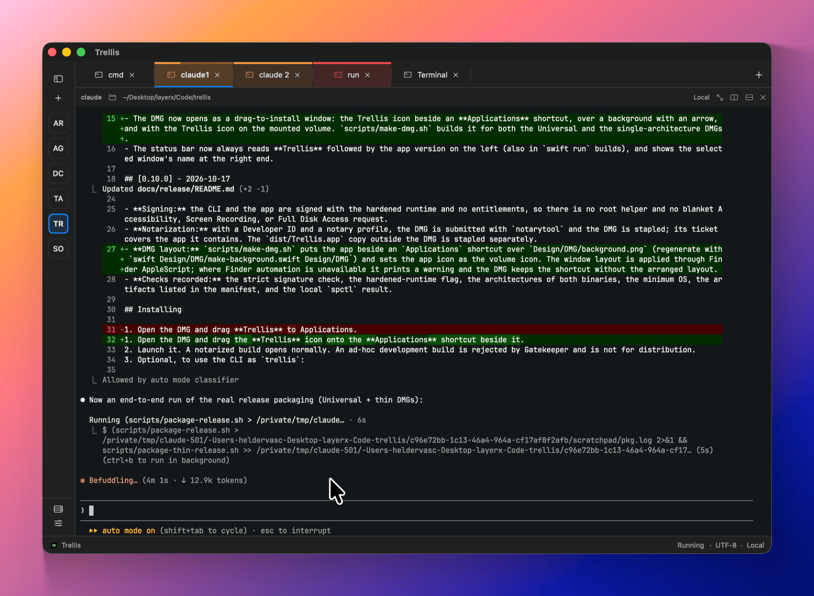

# Trellis

[](https://github.com/bearstouch/trellis/actions/workflows/ci.yml)

A native Swift terminal for macOS. "Native calm" chrome (dark by default, or light or following macOS), dark terminal panes in bundled JetBrains Mono, a sidebar of managed windows, renameable tabs per window, and nested splits, plus saved SSH hosts and a local automation API with a `trellis` CLI.



## Features

- **Workspace:** managed windows in a sidebar, renameable color-labeled tabs and nested splits, with busy and input indicators and desktop notifications. Sessions can optionally keep running after quit.
- **Terminal:** built on a vendored [SwiftTerm](ThirdParty/SwiftTerm/PATCHES.md), with search, safe paste review, links, ligatures, inline images and an optional Metal renderer.
- **Shell integration:** zsh, bash and fish report their directory and exit status with no dotfile edits; jump between prompts with ⌘↑/⌘↓.
- **Themes:** 10 editor-inspired families plus a JSON theme library, with separate light and dark slots and live preview.
- **SSH hosts:** a saved host library and `~/.ssh/config` discovery, using `/usr/bin/ssh` and optional Keychain-stored passwords.
- **Tasks and workspace files:** run `.trellis/launch.json` tasks from a pane header and check a project's layout in as `.trellis/workspace.json`.
- **Automation:** a local JSON-RPC API with scoped grants, the `trellis` CLI, and an optional [MCP server](docs/api/mcp.md) for agents.
- **Keyboard and accessibility:** rebindable shortcuts, Option-as-Meta and accessibility labels throughout.
- **Privacy:** no telemetry; terminal output and typed input are never logged.

See the [feature docs](docs/features/workspace.md) for the full behavior.

## Quick start

```sh
git clone https://github.com/bearstouch/trellis.git
cd trellis
swift build
swift run Trellis --state-directory "$PWD/.build/dev-state"
```

`--state-directory` keeps your development workspace and themes separate from your real `~/Library/Application Support/com.bearstouch.trellis/` data. Use it whenever you hack on Trellis.

## Development setup

### Prerequisites

| Requirement | Version | Notes |
| --- | --- | --- |
| macOS | 14 Sonoma or later | Development is done on recent macOS on Apple silicon |
| Xcode | 26 | Provides Swift 6.2 and `swift format`. Run `sudo xcode-select -s /Applications/Xcode.app` if `xcode-select -p` points at the Command Line Tools |
| Python 3 | Any recent version | Only for `scripts/qualify.py` and the launcher test |
| `librsvg` | Optional | `brew install librsvg`, only to regenerate app icons |

Check your toolchain:

```sh
swift --version        # Apple Swift version 6.2 or later
swift format --version
```

You don't need an Apple Developer account, Homebrew packages, or a package manager bootstrap. SwiftTerm is vendored under `ThirdParty/SwiftTerm`, so `swift build` works offline.

### Editors

- **Xcode:** `open Package.swift`. Choose the `Trellis` scheme to run the app and `Trellis-Package` to run tests. To pass launch arguments such as `--state-directory /abs/path`, edit the scheme (Product → Scheme → Edit Scheme… → Arguments).
- **VS Code / Cursor:** install the [Swift extension](https://marketplace.visualstudio.com/items?itemName=swiftlang.swift-vscode). It reads `Package.swift` directly and uses SourceKit-LSP.

### Everyday commands

```sh
swift build                                   # build (must stay warning-free)
swift test                                    # full XCTest suite, about 20 s
swift test --filter TrellisUITests.TabManagementTests   # one test class
swift format -i -r Sources Tests              # format in place
swift format lint --strict -r Sources Tests   # lint: must print nothing
```

Before every commit, run this one-liner:

```sh
swift format -i -r Sources Tests && swift format lint --strict -r Sources Tests && swift build && swift test
```

Formatting uses the toolchain's `swift format` with the repo [`.swift-format`](.swift-format) (4-space indent, 220 columns). The repo has no SwiftLint or SwiftFormat dependency.

### Running the app

| Command | What it does |
| --- | --- |
| `swift run Trellis` | Runs against your **real** workspace in Application Support |
| `swift run Trellis --state-directory /abs/path` | Uses a separate workspace and theme library (recommended for development) |
| `swift run Trellis --fixture` | Starts an isolated, fixed-shell demo window whose child exits with code 7. The window stays open for inspection |
| `swift run Trellis --no-mcp` | Never starts the MCP server for this launch, whatever Settings → Remote Control says. `--fixture` implies it. |
| `scripts/run-feasibility.sh` | Assembles `.build/Trellis.app`, ad-hoc signs and verifies it, then opens it. Use this when you need a real bundle (icon, Info.plist, resources) |
| `scripts/run-feasibility.sh --build-only` | Same as above without opening a window |

An ordinary new workspace starts a login shell. Use Quit to close live sessions with confirmation.

### Using the CLI against a dev build

1. Run the app, open **Settings → Automation**, and create a grant. The token is shown only once.
2. Save the token to a file that only you can read, for example `.build/token.txt`. Never pass a token as an argument.
3. Call the CLI:

   ```sh
   swift run trellis-cli window list --token-stdin --json < .build/token.txt
   swift run trellis-cli                      # prints the available nouns
   ```

The packaged app ships this binary as `trellis` (see the [release guide](docs/release/README.md)). The protocol is documented in [`docs/api`](docs/api/index.md).

### Other scripts

```sh
python3 scripts/test-feasibility-launcher.py "$(swift build --configuration debug --show-bin-path)"  # launcher regression, no windows
python3 scripts/qualify.py [--quick] [--renderer metal|coregraphics]  # release qualification, about 5 min; opens isolated app windows
python3 scripts/bench-renderer.py [--quick] [--only NAMES]  # Metal vs CoreGraphics benchmarks, about 25 min; keep its windows visible
scripts/package-release.sh                    # Universal 2 app + DMG (ad-hoc unless TRELLIS_SIGN_IDENTITY / TRELLIS_NOTARY_PROFILE)
scripts/generate-app-icon.sh                  # regenerate icons from Design/AppIcon/*.svg (needs rsvg-convert)
```

### CI and releases

- [`ci.yml`](.github/workflows/ci.yml) runs lint, build (no new warnings in project sources), the full test suite and the launcher regression on `macos-26` with Xcode 26. It runs for every pull request to `master` or `develop`, and for every push to those branches.
- [`release.yml`](.github/workflows/release.yml) runs when you push a tag `vX.Y.Z` that matches `release/manifest.json`. It tests, packages the Universal 2 DMG, and publishes a GitHub release whose notes come from the matching `CHANGELOG.md` section. Without signing secrets the build is ad-hoc signed and published as a pre-release. The secrets it uses are listed at the top of the workflow. A manual run builds the DMG as a workflow artifact without publishing anything.

To cut a release, bump `release/manifest.json`, add the `CHANGELOG.md` section, commit, then run `git tag vX.Y.Z && git push --tags`.

## Documentation

The [`docs/`](docs/index.md) folder is the behavior contract and contributor guide: product overview, architecture, features, the automation API and CLI, integrations, macOS support, and development rules. It's plain Markdown, laid out for [MkDocs Material](https://squidfunk.github.io/mkdocs-material/):

```sh
python3 -m venv .venv-docs && .venv-docs/bin/pip install mkdocs-material
.venv-docs/bin/mkdocs serve    # http://127.0.0.1:8000
```

Good starting points:

- [Architecture](docs/architecture/index.md) and the [repository layout](docs/development/getting-started.md#repository-layout)
- [Persistence](docs/architecture/persistence.md): where data lives, recovery and migration from uTerm
- [macOS support](docs/platform/macos.md), including app instances and development builds
- [Themes](docs/features/themes.md) and [Terminal](docs/features/terminal.md): fonts, text rendering, GPU rendering and inline images
- [CONTRIBUTING.md](CONTRIBUTING.md): the rules contributors must follow

## Troubleshooting

- **`swift format` not found:** `xcode-select -p` points at the Command Line Tools. Switch it to Xcode 26.
- **Concurrency errors on build:** you're on an older toolchain. The package requires Swift 6.2 in Swift 6 language mode.
- **The app opens my real workspace:** pass `--state-directory /absolute/path` (the path must be absolute).
- **The ad-hoc `.app` is blocked by Gatekeeper when copied to another Mac:** this is expected. Only Developer ID–signed, notarized builds can be distributed.

## Contributing

Contributions are welcome. Read [CONTRIBUTING.md](CONTRIBUTING.md) for the workflow, code style, test conventions and how to report security issues.

## License

Trellis is released under the [MIT License](LICENSE). The vendored SwiftTerm is also MIT-licensed. Its license, provenance and patch set are in [`ThirdParty/SwiftTerm`](ThirdParty/SwiftTerm/PATCHES.md).
