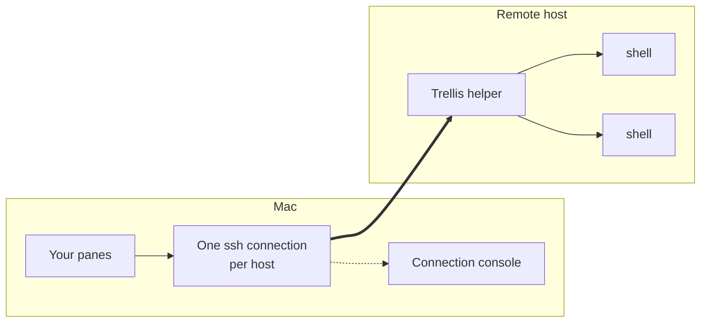

# Remote workspaces

A remote workspace is a space in the sidebar that belongs to one of your [saved SSH hosts](ssh-hosts.md). Every tab and split you open in it runs a shell on that host. The shells are kept by a small Trellis helper running on the remote machine, so they keep running when you quit Trellis, your Mac sleeps or the network drops. When Trellis connects again, your panes pick up where they left off, with the output you missed.

The host can run Linux (x86_64 or aarch64) or macOS (Apple silicon or Intel). Trellis itself runs on your Mac. Remote workspaces are a preview feature.

## How it works



- **One ssh connection per host.** All the remote workspaces on the same host share a single connection, made with your Mac's own `/usr/bin/ssh`. Your `~/.ssh/config`, keys, ssh agent, known-hosts policy and proxies apply as usual. Port forwards from your SSH config are left to your own ssh sessions; the workspace connection doesn't open them.
- **You sign in once per connection,** not once per pane. Checking the host, installing the helper and running your shells all share that connection.
- **Nothing listens on the network.** The helper talks to Trellis only through the ssh connection, and on the host it uses a private socket only your user can open. SSH is the only way in.

## Open a remote workspace

Open **File → Hosts…**, select a host and choose **Open Remote Workspace**. You can also choose **Open Remote Workspace: <host>** in the command palette (<kbd>⇧</kbd><kbd>⌘</kbd><kbd>P</kbd>).

Trellis creates a space named after the host, with one tab whose shell runs there. The sidebar shows the host and the state of its connection. The space stays bound to the host when you relaunch Trellis.

The first time you open a workspace on a host, Trellis checks whether the helper is installed there and asks before installing it. See [The Trellis helper](#the-trellis-helper).

### New tabs and splits

New tabs (<kbd>⌘</kbd><kbd>T</kbd>), splits (<kbd>⌘</kbd><kbd>D</kbd>) and duplicates in a remote workspace run on the same host, in the folder of the pane you started from. After `cd /srv/app`, a new tab opens in `/srv/app` on the host.

Trellis learns that folder from its shell integration on the host. A pane without it, such as an agent pane or a shell that hasn't shown its first prompt yet, gives the folder it started in. If neither is known, or the folder no longer exists, the new shell starts in your home folder on the host.

### Shell integration

The helper brings Trellis's shell integration for zsh, bash and fish. With it, the pane header shows the shell's current folder and the host's name with a server symbol, and the bottom bar shows the focused pane's machine the same way. When the connection is down, the symbol changes and the state is named in words beside it.

Other shells start without integration. They work normally, but new tabs start in the folder the pane started in, or your home folder.

### Projects and tasks on a host

- **Projects:** a [library project](project-library.md) launched on a saved host opens as a remote workspace, with every pane a shell in the project folder on the host. When the folder or a repository is missing, **Set Up & Open** runs the setup in a terminal on the host, in your login shell, so a forwarded ssh agent is available to git. Trellis never writes files on the host itself.
- **Tasks:** the [Tasks](tasks.md) view lists the host's `launch.json` and detected tasks for a remote pane with shell integration, and runs, stops and reviews them as it does locally. **Add to launch.json** isn't available for remote panes.

## The Trellis helper

The helper is the program that keeps your remote shells running. It's the same session helper Trellis uses on your Mac, built for the host's system, and it runs as your user without administrator rights.

### Install it

Each host in **File → Hosts…** has a **Remote helper** section with a status line and these actions:

- **Check Helper Status** connects and reports what's installed, for example "Not installed (Linux aarch64)", "Installed, up to date (Linux aarch64)" or "Update available (Linux aarch64)". Until you check, it reads "Unknown (never checked)". The status is only ever what Trellis found on the host, with when it was checked.
- **Install Trellis Helper…**, or **Update Helper…** when a newer version is available.
- **Remove Helper…**, described below.
- **Install helper automatically when opening a remote workspace**, off by default. When it's off, opening a workspace on a host without the helper asks first; when it's on, later versions are installed without asking.

Before installing, Trellis shows the host, its system and architecture, where the helper will go and its size. Choose **Install** to go ahead or **Cancel** to leave the host untouched. Trellis then:

1. Uploads the helper over your ssh connection, compressed.
2. Checks it on the host against the SHA-256 checksum that ships with Trellis. An upload that doesn't match is deleted and nothing is installed.
3. Moves it into place in one step, so an interrupted upload never leaves a half-written helper.

A host that already has the right version skips the upload. Nothing is written outside `~/.trellis` on the host.

### What it puts on the host

```text
~/.trellis/
  remote/<version>/           the helper and its shell integration scripts
  run/<id>/broker.json        how to reach the running helper
/tmp/trellis-broker-<id>/s    the helper's private socket
```

Everything under `~/.trellis` is readable only by your user. The helper never writes passwords, typed input or terminal output to the host's disk, and never logs them.

Besides your shells, the helper runs only a project's setup in your login shell and `git status`. It reads only task files, owned by you, to list [tasks](tasks.md).

### Remove it

Choose **Remove Helper…** and confirm with **Remove**. Trellis deletes `~/.trellis/remote` and `~/.trellis/run` on the host, and `~/.trellis` itself if that leaves it empty. Nothing else is changed. Removing affects every Mac that uses the host.

If sessions from this Mac are still running there, Trellis says how many and offers **Stop and Remove**; **Cancel** keeps the helper and the sessions. If it can't count them, the helper is kept.

### Updates

After you update Trellis, a helper from the previous version that is still running keeps its sessions and stays in use until it exits, as long as the two versions can still talk. Otherwise Trellis says so and offers to stop it. Old helper versions that nothing uses any more are cleaned up; one that is still running is never removed.

### If the install fails

- "Trellis has no helper for …": the host's system or architecture isn't supported.
- The host needs `gzip`, and `sha256sum`, `shasum` or `openssl` to check the upload. Without them, nothing is installed and Trellis names what's missing.

## The connection console

ssh sometimes needs you: to confirm an unknown or changed host key, or for a password, a key passphrase or a one-time code. Those questions appear in the connection console, a sheet titled **Connecting to <host>** that is ssh's own terminal. Answer them there; Trellis never answers them for you. A [saved password](ssh-hosts.md#saved-passwords) is filled in for ssh's password prompt, as for SSH panes.

If a host key has changed, the console shows ssh's warning and the connection fails. Trellis never bypasses it.

## When the connection drops

Your remote sessions keep running while the connection is down. Trellis notices a lost connection within about 30 seconds of the last traffic, and right away after your Mac wakes or the network changes.

The sidebar and the pane headers name the connection's state in words, with a symbol:

| State | Meaning |
| --- | --- |
| **Connecting…** | Trellis is opening the connection. |
| **Connected** | Everything is up. |
| **Reconnecting (attempt N)…** | Trellis is trying again on its own, waiting a little longer after each failed attempt (from 1 second up to a minute). |
| **Offline, waiting for the network** | Your Mac is offline. Trellis tries again as soon as the network is back. |
| **Reconnect needs you** | ssh needs a password, a passphrase or a host-key decision, so automatic attempts stopped. |
| **Disconnected** | The connection ended and won't be retried on its own. |

While a host is down, every tab with a pane on it shows a red indicator and the connection's symbol until its panes are back.

To reconnect yourself, right-click the space in the sidebar:

- **Retry Now** tries again at once, without prompting.
- **Reconnect to <host>…** opens a connection where ssh can ask its questions in the console. Use this when the state is **Reconnect needs you**.

### Typing while disconnected

Nothing you type is sent or kept for later while the host is unreachable. The first time you type during an outage, Trellis shows "Not sent: reconnecting to <host>". After that, input is dropped silently until the connection is back.

### Missed output

When the connection comes back, each pane shows the output produced while you were away, once, without repeating lines. The host keeps up to 4 MiB of recent output per session. If more was produced, the pane is cleared and shows the most recent 4 MiB. Full-screen programs redraw.

## Quit, relaunch and close

- **Quitting Trellis** doesn't stop anything on the host. When you relaunch, your remote panes reconnect to their sessions once the host is connected, with the output produced meanwhile.
- **A session that ended while you were away** shows its last output and "Session ended while disconnected (exit N)".
- **Sessions no pane claims:** if the host has sessions from this Mac that no pane is waiting for, Trellis tells you how many and offers **Stop Them** or **Leave Running**, once per host.
- **Closing a pane, tab or space** ends its remote sessions, after the usual confirmation.
- **Closing the window** leaves remote sessions running.

Each Mac's sessions are its own: two Macs using the same host see only their own sessions. If your Mac's connection dropped, it takes back its own sessions on the next connection.

**Settings → Session Broker** shows the helper on this Mac and on each connected host.

## Limits

- Remote sessions last as long as the host lets them. A reboot, a crash of the helper or a system policy that ends a user's processes at logout (systemd's `KillUserProcesses=yes`) ends them. Trellis warns when it detects that policy and never turns on lingering for you.
- Automatic reconnects need sign-in without typing anything (keys or an ssh agent). Saved passwords are used only when you reconnect yourself, so a host that signs in with a password always stops at **Reconnect needs you** after a drop.
- Shells started before a reconnect keep their old `SSH_AUTH_SOCK`, so ssh agent forwarding inside them stops working after a reconnect, as it does with tmux.
- A session that ended while you were disconnected keeps its exit status and last output on the host for one day.
- A pane you close while its host is unreachable is ended when Trellis reconnects in the same run. If you quit first, that session keeps running on the host until Trellis offers it with **Stop Them** / **Leave Running**.
- If you start a restored remote pane by hand before Trellis has reconnected it, the start fails because the helper still runs that session. Reconnect instead.
- If the host doesn't answer within 5 seconds when a new session starts, the pane shows that it failed even if the shell did start. That session is then offered with **Stop Them** / **Leave Running**.
- Only the Mac that started a set of sessions can attach to them.
- Opening links to remote files, editing remote task files and general file transfer aren't included.
- Automation can work with remote sessions but can't create remote workspaces. See the [automation API](../api/index.md).
