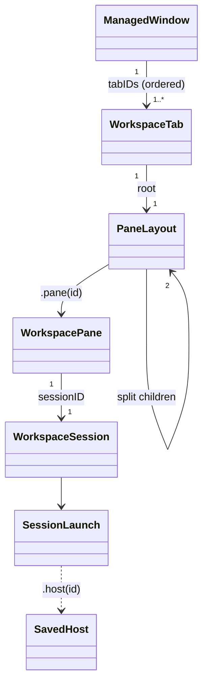

# Domain model

The domain types live in `Sources/TrellisCore/Workspace.swift` unless noted otherwise. They're `Sendable` value types.

| Type | Fields | Notes |
| --- | --- | --- |
| `ManagedWindow` | `id`, `name`, `tabIDs`, `activeTabID`, `revision` | A sidebar "window" (workspace) |
| `WorkspaceTab` | `id`, `windowID`, `title`, `color: TabColor?`, `root: PaneLayout`, `activePaneID`, `revision` | `TabColor` is a fixed palette (`FR-T04`); nil means unlabeled |
| `PaneLayout` | `.pane(UUID)` or `.split(id, axis, ratio, children)` | The binary split tree. `ratio` is the first child's share. `SplitAxis` is `x` (left/right) or `y` (top/bottom). |
| `WorkspacePane` | `id`, `tabID`, `sessionID`, `profileID` (`"default"`), `title?` | Owns exactly one session |
| `WorkspaceSession` | `id`, `launch`, `state`, timestamps, `processID`, `exitCode`, `failureMessage`, `launchAttemptID` | Exists only at runtime; never persisted in this form |
| `SessionLaunch` | `.shell(directory)`, `.host(UUID)`, `.process(executable, arguments, directory)` | |
| `WorkspaceSnapshot` | `revision`, `windows`, `activeWindowID`, `tabs`, `panes`, `sessions` | The whole workspace. `validate()` enforces the invariants listed below. |
| `SavedHost` (`SavedHost.swift`) | `id`, `name`, `destination`, `user?`, `port?`, `identityFile?`, `tags`, `revision`, `connectionRevision` | Never holds passwords or key contents |
| `AutomationGrant` (`TrellisControl`) | `id`, `name`, `tokenHash`, `capabilities`, `windowScope`, `hostScope`, `createdAt`, `expiresAt`, `revokedAt` | The token secret is kept apart from layout data |
| `LayoutDocument`, `LayoutPlan`, `LayoutBinding` (`LayoutDocument.swift`) | | [Declarative layouts](../api/layouts.md) |
| `ThemeDocument`, `ResolvedTheme`, `AppearanceSettings` | | [Themes](../features/themes.md) |
| `WorkspaceEvent` (`WorkspaceEvents.swift`) | | A diff between snapshots, published to the UI and to subscribers |

## Invariants

`WorkspaceSnapshot.validate()` runs on every commit and enforces these rules:

- A window has at least one tab, and a tab has at least one pane. No resource is orphaned.
- Every split has exactly two children, and its ratio is between 0.1 and 0.9.
- Nesting is at most 16 levels deep, and there are at most 100 panes.
- Names and titles are 1–200 characters.
- A `starting` session has a launch attempt ID and no PID. A `running` or `closing` session has a PID, and no two sessions share one.
- An inactive session holds no runtime process ownership.

Here's what happens when a pane closes: its parent split collapses into the sibling that remains, and every remaining ID stays the same. Closing a tab's last pane closes the tab, and closing a window's last tab closes the window. The application itself may have zero windows.

## Identity

- UUIDs stay stable across normal saves and across restoring a stopped layout.
- Restarting a session creates a **new session UUID** in the same pane.
- Export leaves out runtime session IDs, and import assigns new UUIDs.
- Layout `key`s identify objects within a namespace for a deployment. They aren't globally unique IDs.

## Revisions and conflicts

- Every successful mutation increments the snapshot `revision` and stamps it on each window and tab it touched. A no-op command doesn't change the revision.
- Callers can pass a global `expectedRevision`, or a resource expectation (`.window(id, revision)`, `.tab(id, revision)` or `.workspace(revision)`). If it doesn't match, the call fails with `conflict(expected:actual:)`, which becomes `CONFLICT` in the API. Concurrent edits are never silently overwritten.
- Compound operations (`execute(_:expecting:then:)`) roll back to the saved state if the follow-up command fails.
- `WorkspaceError` cases: `invalidState`, `notFound`, `conflict`, `invalidTransition`, `staleLaunch` and `revisionExhausted`.
