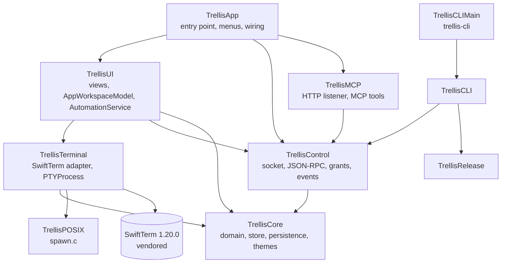
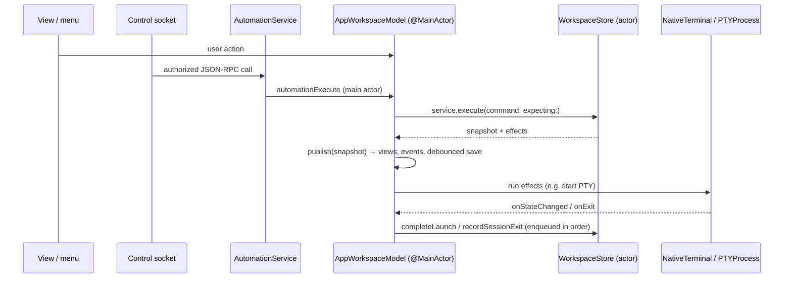

# Architecture

Trellis is native Swift: SwiftUI draws the application chrome, and AppKit hosts the terminal surface and the native responder chain. There's no webview. The package targets macOS 14 and builds in Swift 6 language mode with strict concurrency. Its only external dependency is the vendored `ThirdParty/SwiftTerm`.

## Modules

| Target | Role | Key types |
| --- | --- | --- |
| `TrellisCore` | Domain logic that doesn't depend on the terminal engine. Bundles `Resources/Themes`. | `WorkspaceStore` (actor), `WorkspaceCommand`, `WorkspaceCommandService`, `WorkspacePersistence`, `LocalSessionController`, `LocalLaunchValidator`, `SessionClosureCoordinator`, `HostLibrary`, `SavedHost`, `LayoutPlanner`, `ThemeLibrary`, `ThemeValidator`, `LinkPolicy`, `SecretRedactor`, `OutputJournal`, `ScrollbackBudget` |
| `TrellisPOSIX` | A small C target for PTY spawning and process identity | `trellis_spawn_pty`, `trellis_read_process_identity` |
| `TrellisTerminal` | All SwiftTerm-specific code. **The only module that imports SwiftTerm.** | `NativeTerminal`, `PTYProcess`, `AccessibleTerminalView`, `TerminalScrollback`, `PaneTextSearch`, `TerminalSelectionBookmark`, `TerminalAppearance` |
| `TrellisControl` | The local automation server | `ControlServer`, `ControlEndpoint`, `ControlSession`, `ControlFramer`, `AuthorizingControlHandler`, `AuthorizationPolicy`, `GrantStore`, `KeychainGrantSecretStore`, `EventHub`, `LayoutJSON`, `PortableDocument` |
| `TrellisMCP` | The optional MCP server: an HTTP transport over the same authorizer ([MCP server](../api/mcp.md)) | `MCPServer`, `MCPListener`, `MCPEndpoint`, `MCPTools`, `HTTPRequestParser` |
| `TrellisUI` | SwiftUI and AppKit views, and the bridge between the store, the views and the terminals | `AppWorkspaceModel` (`@MainActor ObservableObject`), `AutomationService`, `WorkspaceRootView`, `PaneTreeView`, `HostListModel`, `DiagnosticsExporter`, `PortableTransfer`, settings views |
| `TrellisApp` | The `Trellis` executable. Wires everything together. | `TrellisMain` (`@main`), `AppDelegate` (menus, shortcuts, termination), `EventForwarder` |
| `TrellisRelease` | Release-time policy | `ReleaseManifest`, `CLILinkPlanner`, `UninstallPlanner`, `ReleaseChecklist` |
| `TrellisCLI` / `TrellisCLIMain` | The `trellis-cli` executable, installed as `trellis` | `CLI`, `SocketTransport`, `Resolver`, `CLICommands` |

## Logical components

| Component | Responsibility | Where |
| --- | --- | --- |
| App shell | Scene and window lifecycle, menus, sidebar, tab bar, settings | `TrellisApp`, `TrellisUI` |
| Workspace store | Authoritative windows, tab order, split trees, selection and revisions | `WorkspaceStore` |
| Command service | Validated domain operations shared by the UI, the CLI and agents | `WorkspaceCommandService` |
| Terminal adapter | Engine-independent view, selection, paste, resize and screen access | `TrellisTerminal` |
| Session manager | PTY allocation, launch, size, I/O, exit and teardown | `LocalSessionController`, `PTYProcess` |
| Host repository | Saved hosts and read-only SSH config discovery | `HostLibrary` |
| Theme service | Validate, install and resolve themes; keep SwiftUI and the terminal consistent | `ThemeLibrary`, `TerminalAppearance` |
| Persistence | Versioned atomic snapshots, migration, backup and recovery | `WorkspacePersistence` |
| Automation server | Authentication, authorization, framing, subscriptions and limits | `TrellisControl` |
| CLI | A structured client with machine-readable output and exit codes | `TrellisCLI` |

## One mutation path

Every change to the workspace goes through a single command boundary:

- `WorkspaceCommand` is a closed enum of mutations. Commands never perform I/O.
- `WorkspaceStore.execute` checks the optional revision expectations, copies the state, bumps the revision, runs `validate()` on the result, and commits it. If anything fails, the previous state is kept.
- **A process launch is an effect that happens after the commit.** `.startSession` moves the session to `starting`, stamps it with a `launchAttemptID`, and returns a `.start` effect. The model performs the spawn and then reports `.completeLaunch` with that attempt ID. A stale attempt is rejected, so a failed launch produces a failed session and never a dangling reference in the tree.
- `AppWorkspaceModel.enqueue` chains callbacks from terminals so they reach the store in order.
- Automation never gets a side door. `AutomationService` calls the same model entry points as the UI, which apply the same closing-hierarchy gates.

## Threading

- Workspace mutations are serialized inside the `WorkspaceStore` actor. Persistence and the theme library are actors as well.
- PTY I/O and output parsing run off the main thread. View updates run on `@MainActor`.
- Large output is bounded by the scrollback budget and the output journal, so it can't block UI input.
- Events follow committed changes in order. Transient output has its own bounded sequence.

## Deeper dives

- [Domain model](domain-model.md): types, invariants and IDs
- [Sessions and processes](sessions.md): lifecycle, spawning, environment and closing
- [Persistence](persistence.md): files, atomicity, recovery and migration
- [Terminal engine](terminal-engine.md): the SwiftTerm adapter, patches, scrollback and output security
