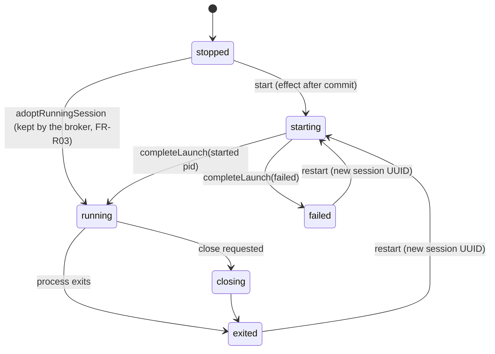

# Sessions and processes

## Lifecycle

- A **stopped** pane has a session record but no process. Restored workspaces always start in this state. The only way out other than **start** is adopting a session the broker kept running (see [Session broker](#session-broker)); nothing is spawned for it.
- **Restart** creates a new session UUID in the same pane. Output cursors from the old session become invalid.
- An exited or failed session stays visible, with its exit status, until it's restarted.
- `LocalSessionController` (in `TrellisCore`) drives the transitions without knowing about the terminal engine. `NativeTerminal` (in `TrellisTerminal`) connects it to a view.

## Launching

The launch descriptor is validated before any process exists (`LocalLaunchValidator`):

- The executable and working directory must be absolute paths with no NUL, and the directory must exist and be accessible. Otherwise the session fails before spawning (`FR-S05`).
- The interactive shell is the account's login shell (from `getpwuid_r`, falling back to `/bin/zsh`), run with `-l`.
- **Environment:**
    - The child inherits the app's environment plus allowed overrides.
    - Variables with a `TRELLIS_`, `__TRELLIS_`, `UTERM_` or `__UTERM_` prefix are removed when inherited and rejected when passed as overrides. This keeps application control secrets out of shells.
    - `ITERM_SESSION_ID` and `TERM_SESSION_ID` are removed.
    - Sessions of a host with a saved password also get `SSH_ASKPASS`, `SSH_ASKPASS_REQUIRE=force`, `SSH_ASKPASS_TRELLIS_SOCKET` and `SSH_ASKPASS_TRELLIS_NONCE` (one-time, not a secret). These names avoid the reserved `TRELLIS_` prefix. See [saved passwords](../features/ssh-hosts.md#saved-passwords).
    - `TERM=xterm-256color`, `COLORTERM=truecolor`, `TERM_PROGRAM=Trellis`, `LC_TERMINAL=iTerm2` and `LC_TERMINAL_VERSION=3.5.0` are set, replacing inherited values ([inline images](../features/terminal.md#inline-images), FR-IM05).

`trellis_spawn_pty` in `Sources/TrellisPOSIX/spawn.c` does the spawn:

1. Uses `forkpty`, so the child gets a controlling terminal and its own session and process group, at the initial size.
2. In the child, resets every signal handler and the signal mask, closes every descriptor above 2, then runs `chdir` and `execve`.
3. Reports an `exec` failure back to the parent through a close-on-exec error pipe.
4. If anything fails, the parent kills and reaps the child. On success, the master descriptor is made close-on-exec.

`PTYProcess` owns the master descriptor. It reads output off the main thread and forwards resizes as `TIOCSWINSZ`, so the shell gets `SIGWINCH`. It reaps the child and reports the exit status as `WEXITSTATUS`, or 128 + signal number.

## Process ownership

Trellis must never signal a PID that the OS has reused for another process.

- At launch, `OwnedProcessIdentity` records the pid, parent pid, process group and start time.
- A signal is sent to the group (`kill(-pid, …)`) only if all four still match (`permitsSignal`).
- If `PTYProcess` is deinitialized while its child still lives, it kills the group only after the same check.

## Closing (SessionClosureCoordinator)

`SessionClosureCoordinator` in `SessionClosure.swift` is the shared close policy. It never shows UI itself. Its time and sleep functions are injected, so tests run deterministically.

1. If any affected session is running and the caller hasn't confirmed, the result is `confirmationRequired`, along with the affected sessions. The UI turns that into a single confirmation dialog summarizing every pane involved (`FR-T03`). The API returns `CONFIRMATION_REQUIRED`.
2. If the close is confirmed, SIGHUP goes to each terminal process group, matching terminal hangup behavior. Interactive shells such as zsh ignore SIGTERM, so sending SIGTERM here would cause an unnecessary force-stop prompt. The coordinator then polls every 20 ms for up to **2 seconds**.
3. If a process is still alive, the result is `closePending`. The UI offers an explicit **Force** option, and the API returns `CLOSE_PENDING`; the client must send `force: true`. Force (SIGKILL) is allowed only after a graceful attempt that's at least 2 seconds old.
4. The store refuses to delete a pane, tab or window while any of its sessions is starting, running or closing. The hierarchy is removed only after cleanup finishes.

Cancelling a confirmation sends no signal. Closing a pane doesn't guarantee that remote processes stop, including anything detached with tmux or nohup.

Every 100 create/close cycles must leave no orphaned PTYs, no unreaped children and no growth in descriptor count (verified by `scripts/qualify.py`).

## Session broker

New sessions are owned by `trellis-broker` (FR-R07), a helper bundled beside the app (`Contents/Helpers`; `swift run` builds it beside the app binary), whatever **Stop sessions when Trellis quits** says: that setting decides only what quitting and closing the window do (FR-R03). Every launch looks for a broker left by an earlier run, so kept sessions are never orphaned silently. The broker relays bytes only; terminal emulation stays in the app, so full-screen programs behave as on a direct PTY.

**Starting it.** The first session started asks the broker client to `prepare`: connect to the broker named in `<state>/broker.json`, or start a new one with `trellis_spawn_detached` (double fork, `setsid`, stdio on `/dev/null`, default signals and mask, descriptors above 2 closed, empty environment, the intermediate child reaped). Its argv is `--socket <0700 dir in $TMPDIR>/s --client <app executable> --idle-exit 30`. It sets `RLIMIT_CORE` to 0 and ignores SIGPIPE. After a successful hello the app writes `broker.json` (mode `0600`), so each state directory has its own broker. A live broker that answers but turns the app away (another protocol version, still holding a previous client, or not the `trellis-broker` at this app's path, as after moving the app) is never replaced, since overwriting `broker.json` would orphan its sessions. If the broker can't start or can't be used, the session runs as a local PTY and the app says it will end at quit.

**Authentication, both ways.** The socket is `0600` inside a fresh `0700` directory owned by the user. Each side checks the other with `getpeereid` (same uid) and `LOCAL_PEERPID` + `proc_pidpath`: the broker accepts only the `--client` executable, and the app only the bundled `trellis-broker`. One client at a time; a second is refused with `BROKER_BUSY`. An answering socket that isn't the broker is left alone.

**Protocol.** Frames are `[u32 big-endian length][u8 kind][payload]`, at most 1 MiB; output, replay and input chunks are at most 64 KiB. Kinds are control (Codable JSON with an optional request ID), input, output and replay (16-byte session UUID + bytes), and `stopAll`, which every protocol version accepts from an authenticated peer. Requests: `hello`/`welcome`/`refused`, `spawn`/`spawned`, `list`/`sessions`, `attach` (replay frames, then `attached`), `resize`, `signal`, `release`, `detach`; events `exited`, `prompt` and `inputRejected` (sent only to a client whose `hello` lists the `inputRejected` feature, so an older app never gets an event it can't decode); failures carry SCREAMING_SNAKE codes (`SIGNAL_REFUSED`, `SESSION_RUNNING`, `NOT_FOUND`, `INVALID_REQUEST`, `SPAWN_FAILED`). **Versions.** `hello` carries the lowest version the client speaks (`protocolVersion`) and, from version 2, the highest (`maximumVersion`); the broker answers with the highest both speak, and a version-1 broker, which reads only `protocolVersion`, keeps accepting an updated app. Version 2 adds, for [remote workspaces](../features/remote-workspaces.md): host facts in `welcome`, `attach(since:)` with an `offset` and `resumed` flag for duplicate-free resume, `ping`/`pong`, and, on remote brokers only, `spawnLogin`, `stat` and `readFile` (failures `NOT_ALLOWED`, `TOO_LARGE`, `UNREADABLE`) and the refusals `CLIENT_MISMATCH` and `PROTOCOL_VERSION_MISMATCH`.

**PTYs and signals.** The broker spawns with the same `trellis_spawn_pty`, so its children are its own process-group leaders. Signal ownership is checked **in the broker**, against its own pid, with the same rule as `OwnedProcessIdentity` (pid, parent, group and start time must still match). Only SIGHUP, SIGTERM and SIGKILL are accepted; an ended session's PID is never signalled. The C copies of the environment are zeroed after each spawn; a shell-integration nonce stays only in broker memory and is returned on attach so the pane can authenticate marks again.

**Output ring and replay.** Each session keeps its newest 4 MiB of output (64 MiB across sessions, trimming the largest first). Evicted bytes still pass through a mode tracker (alternate screens 47/1047/1049, bracketed paste 2004, cursor keys 1, mouse 1000–1006, cursor visibility 25). A truncated replay is `ESC c`, the modes in force at the first whole line, then output from that line (output with no line break in its first 64 KiB is kept from the cut). While attached, output is forwarded live and kept in the ring; reads pause while more than 1 MiB waits for the app. On attach the broker resizes the PTY and sends SIGWINCH to its foreground group. It pushes the password-prompt state (echo off, canonical on, checked 100 ms after I/O). Input a session can't take yet is held up to 1 MiB; beyond that the broker refuses it, tells the app once (`inputRejected`, shown like a full local input queue) and drops the rest of that input until the backlog drains, so a paste is cut short instead of written with gaps. The app sends an input whole or not at all.

**Replay is display only.** While `NativeTerminal` parses a replay, a restored scrollback file or the ended-session notice, every reply the engine would send to the program (DA, DSR, cursor reports, kitty queries, OSC 99 and cell-size answers) is dropped, and attention, desktop notifications, progress, the bell and the output journal are suppressed. Shell-integration marks in it are applied, but never post FR-SI08 notifications.

**Quit and relaunch.** With Stop sessions when Trellis quits off (the default), ⌘Q quits without asking when every running session is in the broker, and offers Keep Running (default), Stop Sessions or Cancel when some aren't. Keep Running first turns every broker session's signalling off (`setKeepAlive`), closes sessions that aren't in the broker as usual, saves the scrollback file and the workspace, and detaches. A cancelled or failed quit turns signalling back on. Closing the native window only hides it, unless Stop sessions when Trellis quits is on. A `--fixture` launch (scripted qualification and benchmark runs) ends sessions at quit and window close for that launch only, without changing the saved setting; its sessions still run in the broker. A crash or force quit leaves broker sessions running; the next launch adopts them the same way. On relaunch, `reattachBrokerSessions` lists the broker's sessions: a stopped pane with the same session UUID adopts a running one (`.adoptRunningSession`, then replay, then live I/O at the pane's size); an SSH pane registers its passive marks again (FR-SI09). A session that ended meanwhile shows its replay and "— Session ended while Trellis was closed (exit N) —", stays stopped and is released. Unclaimed running sessions get **Stop Them** (SIGHUP, through the broker's ownership check) or **Leave Running**; a broker of another protocol version can only be stopped (`stopAll`).

**Lifetime.** The broker exits 30 s after it has no running session and no client, removing its socket. SIGTERM (or `stopAll`) hangs up every session it still owns and exits. Sessions don't survive logout or a restart, a broker crash ends them, and kept SSH sessions lose saved-password answers after relaunch because the askpass socket belonged to the previous app run (see [Status](../overview/status.md#known-limits)).

## SSH sessions

A saved host is launched as `/usr/bin/ssh [-p port] [-l user] [-i identity] -- destination`. The arguments are an array; no shell is involved. The host is resolved when the session spawns, so editing a host affects only later connections. A live SSH client is `running`, and Trellis never infers that authentication succeeded. See [SSH hosts](../features/ssh-hosts.md).

## What Trellis doesn't know

Without [shell integration](../features/shell-integration.md) (local zsh, bash and fish only), Trellis knows the initial working directory, but not the shell's current directory, the active command, or whether a command finished. A process's exit status means **the launched process** exited. It doesn't say whether the last command typed into an interactive shell succeeded.
