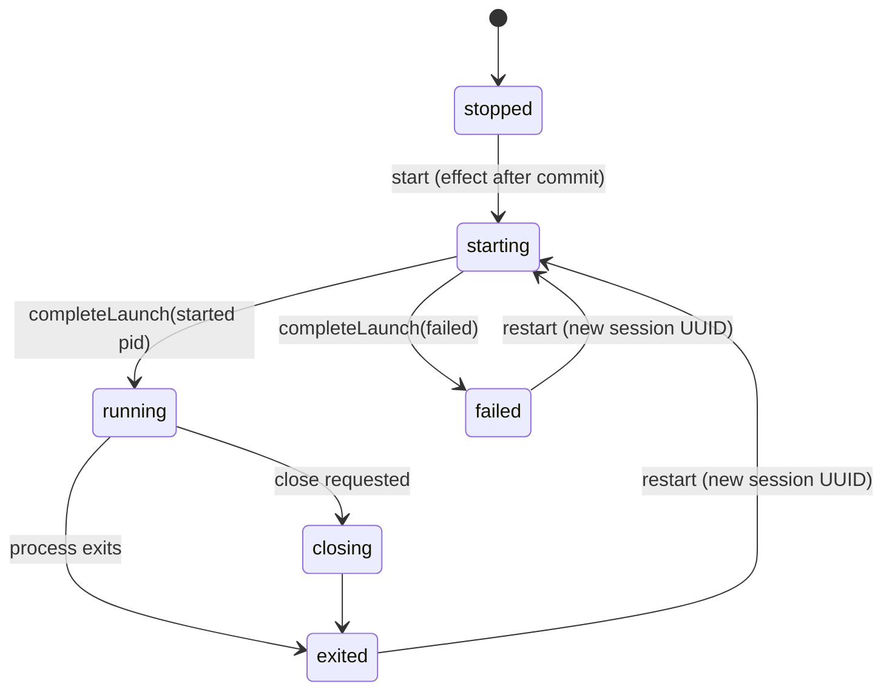

# Sessions and processes

## Lifecycle

- A **stopped** pane has a session record but no process. Restored workspaces always start in this state.
- **Restart** creates a new session UUID in the same pane. Output cursors from the old session become invalid.
- An exited or failed session stays visible, with its exit status, until it's restarted.
- `LocalSessionController` (in `TrellisCore`) drives the transitions without knowing about the terminal engine. `NativeTerminal` (in `TrellisTerminal`) connects it to a view.

## Launching

The launch descriptor is validated before any process exists (`LocalLaunchValidator`):

- The executable and working directory must be absolute paths with no NUL, and the directory must exist and be accessible. Otherwise the session fails before spawning (`FR-S05`).
- The interactive shell is the account's login shell (from `getpwuid_r`, falling back to `/bin/zsh`), run with `-l`.
- **Environment:**
    - The child inherits the app's environment plus allowed overrides.
    - Variables with a `TRELLIS_`, `__TRELLIS_`, `UTERM_` or `__UTERM_` prefix are removed when inherited and rejected when passed as overrides. This keeps application control secrets out of shells (`NFR-S08`).
    - `ITERM_SESSION_ID` and `TERM_SESSION_ID` are removed.
    - `TERM=xterm-256color`, `COLORTERM=truecolor` and `TERM_PROGRAM=Trellis` are set.

`trellis_spawn_pty` in `Sources/TrellisPOSIX/spawn.c` does the spawn:

1. Uses `forkpty`, so the child gets a controlling terminal and its own session and process group, at the initial size.
2. In the child, resets every signal handler and the signal mask, closes every descriptor above 2, then runs `chdir` and `execve`.
3. Reports an `exec` failure back to the parent through a close-on-exec error pipe.
4. If anything fails, the parent kills and reaps the child. On success, the master descriptor is made close-on-exec.

`PTYProcess` owns the master descriptor. It reads output off the main thread and forwards resizes as `TIOCSWINSZ`, so the shell gets `SIGWINCH`. It reaps the child and reports the exit status as `WEXITSTATUS`, or 128 + signal number.

## Process ownership

Trellis must never signal a PID that the OS has reused for another process.

- At launch, `OwnedProcessIdentity` records the pid, parent pid, process group and start time.
- A signal is sent to the group (`kill(-pid, …)`) only if all four still match (`permitsSignal`).
- If `PTYProcess` is deinitialized while its child still lives, it kills the group only after the same check.

## Closing (SessionClosureCoordinator)

`SessionClosureCoordinator` in `SessionClosure.swift` is the shared close policy. It never shows UI itself. Its time and sleep functions are injected, so tests run deterministically.

1. If any affected session is running and the caller hasn't confirmed, the result is `confirmationRequired`, along with the affected sessions. The UI turns that into a single confirmation dialog summarizing every pane involved (`FR-T03`). The API returns `CONFIRMATION_REQUIRED`.
2. If the close is confirmed, SIGTERM goes to each process group. The coordinator then polls every 20 ms for up to **2 seconds**.
3. If a process is still alive, the result is `closePending`. The UI offers an explicit **Force** option, and the API returns `CLOSE_PENDING`; the client must send `force: true`. Force (SIGKILL) is allowed only after a graceful attempt that's at least 2 seconds old.
4. The store refuses to delete a pane, tab or window while any of its sessions is starting, running or closing. The hierarchy is removed only after cleanup finishes.

Cancelling a confirmation sends no signal. Closing a pane doesn't guarantee that remote processes stop, including anything detached with tmux or nohup.

Every 100 create/close cycles must leave no orphaned PTYs, no unreaped children and no growth in descriptor count (`NFR-R01`, verified by `scripts/qualify.py`).

## SSH sessions

A saved host is launched as `/usr/bin/ssh [-p port] [-l user] [-i identity] -- destination`. The arguments are an array; no shell is involved. The host is resolved when the session spawns, so editing a host affects only later connections. A live SSH client is `running`, and Trellis never infers that authentication succeeded. See [SSH hosts](../features/ssh-hosts.md).

## What Trellis doesn't know

Without shell integration (P1), Trellis knows the initial working directory, but not the shell's current directory, the active command, or whether a command finished. A process's exit status means **the launched process** exited. It doesn't say whether the last command typed into an interactive shell succeeded.
