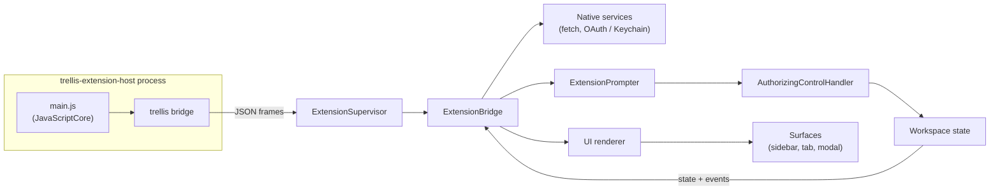

# Trellis Extensions: specification (draft)

> **Draft for review** (2026-11-09). Nothing here is implemented. Once it is agreed, it is split into `docs/features/extensions.md` and the `docs/api/extensions*.md` pages, following [the contribution workflow](../../development/workflow.md). Until then, the stories in this folder track the work: see [Stories](#stories).

## Summary

Trellis Extensions let third parties add commands, event-driven automation, and **native** UI to Trellis. That UI can appear in the sidebar, as a tab, or as a modal. Extensions are JavaScript that runs in a separate, permissioned host process. They describe their UI as a tree of Trellis components, which Trellis renders with its own SwiftUI views. **No extension ever gets a web view, the DOM, or Trellis's own view hierarchy.**

**Status:** draft v2, revised after the [UI research](https://claude.ai/artifact/78gnsENXV4jtCUDp4GCEqm). Nothing is implemented. Once agreed, it becomes `docs/features/extensions.md` and `docs/api/extensions.md`, with requirement IDs FR-EX01–FR-EX29.

**Two tiers**

| Tier | What an extension can do | Rendered by |
| --- | --- | --- |
| **0: commands and events** | Palette commands and keybindings; listen to events; read Trellis state; act through the control API; badges and status text; open terminal panes running a command; contribute settings | Existing Trellis chrome (palette, dock badge, tab bar, Settings) |
| **1: native UI** | Sidebar apps, tabs and modals built from a fixed set of 21 components (lists, rows, Markdown detail, forms, actions with shortcuts…) | Trellis's SwiftUI renderer |

**Goals**

- Extensions look and behave exactly like built-in views. They get the theme, light and dark mode, focus, keyboard shortcuts and VoiceOver for free, because Trellis draws every pixel.
- Extensions can read Trellis state (spaces, tabs, panes, sessions, agents, the focused context and repository), listen to its events, and act through the same control API as the CLI and MCP, limited to what the user approved.
- A small, versioned, data-only UI contract that Trellis can re-render however it likes, so Trellis's own redesigns never break extensions.
- Hot reload and a `check` command, so iterating is fast without a web stack.
- Disabling an extension is instant and leaves nothing behind.

**Non-goals**

- **Web views of any kind, HTML or custom drawing.** Charts, rich diffs and HTML previews are out of scope until the component set grows to cover them.
- Extension panes inside a split, persisted extension tabs, status bar items, a marketplace, signed packages or auto-updates.
- Native extension bundles (Swift, dylibs, ExtensionKit).
- Running extensions on remote hosts. Extensions run on the Mac and reach remote workspaces only through the control API.

## Why native

The closest precedents for a native Mac host draw extension UI themselves from data or a component tree: Raycast, Alfred and herdr. Hosts that offer web views tell authors to avoid them. For a terminal, the deciding issue is keyboard focus, and a native tree joins Trellis's existing focus, shortcut and accessibility model with no new boundary.

| Borrowed from | What Trellis takes |
| --- | --- |
| [Raycast](https://www.raycast.com/blog/how-raycast-api-extensions-work) | JS in a separate process emits a JSON render tree; only diffs cross to the host; a small fixed component set (List, Detail, Form, ActionPanel) with keyboard shortcuts on every action |
| [herdr](https://github.com/herdrdev/herdr-app/blob/master/defaults/AGENTS.md) | Hot reload that keeps the last good version; a `check` command; first-party UI built from the same parts extensions use |
| [Muxy 2.x](https://muxy.app/docs/2.x/extensions/permissions) | Declared permissions, runtime prompts with remembered choices, an audit log; extensions start disabled |
| VS Code | Declarative `contributes` (commands, keybindings, settings); an `engines` version range; no access to the host's own UI |
| [Adaptive Cards](https://learn.microsoft.com/en-us/adaptive-cards/) | The host owns the look; unknown elements degrade to a fallback; "when in doubt, keep it out" |
| [Figma](https://www.figma.com/blog/how-we-built-the-figma-plugin-system/) | Extension logic isolated from the host; all access goes through messages |

**What we give up.** Without web views, extensions can't draw charts, canvases or arbitrary HTML. The component set has to grow to meet real needs, at roughly a week per component. That cost is accepted in exchange for owning the keyboard, the accessibility tree, and a contract that survives Trellis's redesigns.

**Security is unchanged by this choice.** The 2023–2026 extension incidents came from privileged code and update channels, not from rendering. The protections live in the runtime: approved permissions, runtime prompts, origin-limited fetch, Keychain tokens, and the grant handler.

## Package and manifest

An extension is a folder `<state-dir>/Extensions/<name>/` holding a `package.json` with a `trellis` key and **one JavaScript entry file**. There is no HTML or CSS. If `dist/package.json` exists, Trellis reads that instead and resolves paths inside `dist/`, so authors can bundle with esbuild or Vite and write TypeScript. Paths never leave the extension root.

```
Extensions/pr-board/
  package.json      (or dist/package.json after a build)
  main.js           single bundled script, ES2022, no imports at runtime
  icon.svg          optional
```

**Example**

```json
{
  "name": "pr-board",
  "version": "0.1.0",
  "engines": { "trellis": ">=1.2.0" },
  "trellis": {
    "displayName": "PR Board",
    "description": "Open pull requests for the focused project",
    "icon": { "svg": "icon.svg" },
    "main": "main.js",
    "permissions": ["metadata.read", "git.read", "terminal.open", "clipboard.write", "auth", "storage"],
    "network": ["https://api.github.com"],
    "events": ["selection.pane", "session.state", "agent.state"],
    "oauth": [{ "id": "github", "flow": "device", "device": "https://github.com/login/device/code",
                 "token": "https://github.com/login/oauth/access_token", "clientId": "Iv1.0123456789abcdef", "scopes": [] }],
    "contributes": {
      "sidebar": [{ "id": "main", "title": "PRs", "view": "prList", "machines": ["local"] }],
      "tabs":    [{ "id": "board", "title": "PR Board", "view": "prBoard" }],
      "modals":  [{ "id": "checkout", "title": "Check Out Pull Request", "view": "checkoutForm", "size": "medium" }],
      "commands": [
        { "id": "refresh", "title": "PR Board: Refresh" },
        { "id": "open", "title": "PR Board: Open Board", "opens": "tab:board" },
        { "id": "checkout", "title": "PR Board: Check Out PR…", "opens": "modal:checkout" }
      ],
      "keybindings": [{ "command": "refresh", "suggested": "⌥⌘R" }],
      "settings": [{ "key": "includeDrafts", "title": "Include drafts", "type": "bool", "default": true }]
    }
  }
}
```

**Fields**

| Field | Required | Rule |
| --- | --- | --- |
| `name` | yes | `[a-z0-9][a-z0-9.-]{0,63}`; equals the folder name; `trellis-` prefix reserved for bundled extensions |
| `version` | yes | semver |
| `engines.trellis` | yes | semver range; an unsatisfied range suspends the extension with the needed version named |
| `trellis.displayName` | yes | 1–60 characters, no control characters |
| `trellis.description` | no | ≤ 200 characters |
| `trellis.icon` | no | `{symbol}` (SF Symbol), `{monogram}` or `{svg}` (≤ 32 KB, sanitized like agent icons, tinted as a template) |
| `trellis.main` | yes | relative `.js` path, ≤ 4 MB |
| `trellis.permissions` | no | known names only; an unknown name fails the load |
| `trellis.network` | no | https origins, one leading `*.` wildcard allowed, ≤ 16 |
| `trellis.events` | no | known event names; an unknown name fails the load |
| `trellis.oauth` | no | see OAuth and secrets; needs `auth` |
| `contributes.sidebar` | no | ≤ 4: `id`, `title`, `view`, optional `icon`, `machines` (`local`, `remote`, `ssh`; default local + remote) |
| `contributes.tabs` | no | ≤ 8: `id`, `title`, `view`, optional `icon` |
| `contributes.modals` | no | ≤ 8: `id`, `title`, `view`, `size` = `small` (420 pt) \| `medium` (560 pt) \| `large` (760 pt) |
| `contributes.commands` | no | ≤ 32: `id`, `title`, optional `opens` = `sidebar:<id>` \| `tab:<id>` \| `modal:<id>` |
| `contributes.keybindings` | no | `command` must exist; `suggested` chord applied only if free; chords must include ⌘ |
| `contributes.settings` | no | ≤ 32: `key`, `title`, `type` = `string` \| `bool` \| `number` \| `enum` (+ `options`), `default`; keys containing token, secret or password are rejected |

**Validation** follows `AgentDefinitionValidator`: a 64 KB cap on `package.json`, a header-version decode first, every problem collected as an issue, and an invalid folder never hiding valid ones. Every reference must resolve: a command's `opens`, a keybinding's `command`. Each `view` must be defined by `main.js` once it loads; an undefined view shows an error placeholder and is logged.

## Permissions and trust

Trust has three layers:

1. The extension declares what it needs.
1. The user approves that when enabling it.
1. Dangerous actions also prompt at runtime.

Every state read and every action then goes through the same `AuthorizingControlHandler` as the CLI and MCP.

**Permissions**

Permissions reuse the automation grant capabilities by name, so `docs/api/authorization.md` stays the single definition. A few extension-only permissions are added.

| Permission | Grants | Runtime prompt |
| --- | --- | --- |
| `metadata.read` | Read spaces, tabs, panes, sessions, agents and the focused context; subscribe to their events | — |
| `layout.write` | Create, rename, split, focus and close stopped containers | — |
| `session.start` | Start a stopped session with its saved shell | — |
| `session.input` | Type into a pane (equivalent to running commands there) | per pane, remembered until that pane closes |
| `session.execute` | Start executables or submit commands in existing panes | per command line, remembered |
| `session.output.read` | Read the screen, scrollback and output events | per extension, remembered |
| `session.close` | End sessions | per action |
| `theme.read` / `theme.write` | Read themes; change appearance | `theme.write`: per action |
| `host.read` / `host.write` | Read saved hosts; change them | `host.write`: per action |
| `git.read` *(new)* | The focused pane's repository: root, branch, head, remotes. This reveals the repository's folder path, and the approval sheet says so | — |
| `storage` | The extension's own key-value storage (1 MiB) | — |
| `notifications` | Desktop notifications and in-window toasts | — |
| `auth` | OAuth sign-in and `auth.fetch` with declared providers | the sign-in is the consent |
| `secrets` | Keychain items owned by the extension | — |
| `terminal.open` (new) | Open a new terminal pane running a command. It gives no power over existing panes, so an extension doesn't need layout.write, session.start or session.execute for this | every time, with the exact command line; Always Allow is per command line |
| `clipboard.write` (new) | Copy text to the clipboard, only within 5 s of a user action. Reading the clipboard is never available | — |

The first `fetch` to each declared origin prompts once and is remembered. Badges, settings, logs, theme tokens and the extension's own views need no permission.

**Approval on enable**

- A new folder appears in Settings → Extensions as **Disabled**.
- Enabling it shows a sheet listing, in words, every permission, network origin, OAuth provider and event.
- The approved set is stored exactly. A later manifest that asks for more suspends the extension until the user re-approves; asking for less never prompts.

**Approval is pinned to the code**

- Approving an extension records a SHA-256 hash of its manifest and `main.js`.
- If the files on disk no longer match, the extension is suspended and its remembered choices are not used until the user approves again. A process that rewrites `main.js` therefore can't inherit the approval.
- **Development mode** is a per-extension toggle in Settings. While on, edits reload without re-approval, the dock icon and Settings row carry a "Dev" marker, and remembered "Always Allow" choices are ignored, so every dangerous action prompts.
- Extensions made with Create Extension… start in Development mode. Extensions installed from a folder start pinned.

**Runtime prompts**

- **Never window-modal in the background.** A call that the user's own action triggered within the last 5 s (a command, or an action in the extension's view) shows a sheet. Any other call queues a request: the extension's dock icon shows a "needs permission" mark, and the request appears as a banner at the top of that extension's view and in Settings. Typing in a terminal is never interrupted.
- **What it says.** The prompt names the extension, the action and the target, e.g. "PR Board wants to run `gh pr checkout 42` in a new tab of space *Backend*". Command lines are shown in full, in monospace, with control and invisible characters made visible.
- **Choices:** **Allow Once**, **Always Allow**, **Deny**, **Always Deny**.
- **What Always Allow covers:**
    - `session.input`: one pane, until that pane closes. It is never offered for SSH or remote-workspace panes, which prompt every time.
    - `session.output.read`: the extension, all panes.
    - `session.execute` and `terminal.open`: one exact command line.
    - fetch: one origin.
- **Limits.** A request is denied after 60 s unanswered when shown as a sheet, and after 10 minutes when queued. At most 5 can wait per extension; the 6th is refused with `PROMPT_LIMIT`.
- Remembered choices are listed and revocable on the extension's Settings page.

**Audit log**

- Every mutating call and every prompt decision is logged with the time, method, target IDs and decision.
- Input, output and secrets are never logged.
- The log is capped at 1 MiB and rotates once.

**One authorization path**

- Each extension is an `ExtensionPrincipal` with a stable UUID. It resolves to an `AutomationGrant` built in memory:
    - capabilities = the approved permissions
    - space scope `all`
    - host scope approved-none
    - no expiry while the extension is enabled
- **Code change needed.** Today `AuthorizingControlHandler.dispatch` and `EventHub` both look grants up in `GrantStore` by ID, on every call and every delivery. Both move to a small `GrantResolving` protocol. `GrantStore` implements it for user grants and the extension registry for extension grants, so calls and event delivery share one check.
- Capability checks, `NOT_FOUND` scoping and all-spaces rules apply unchanged. The prompter runs after authorization and before execution.
- `grants.json` is never touched. A disabled or suspended extension resolves to no grant, so its calls fail with `AUTH_REQUIRED` and its events stop at the next delivery.
- `terminal.open` and `clipboard.write` are handled by the bridge itself, since they have no control-API method. They are still checked against the approved permissions, prompted and audited.

**Threat model.** These controls stop an extension from exceeding what the user approved. They don't protect against malware already running as the user, and extensions remain code the user chose to trust.

## Runtime and isolation

Each enabled extension runs in its own **`trellis-extension-host`** helper process, which embeds JavaScriptCore. The JavaScript gets no DOM, no file system, no sockets, no `require` and no subprocesses. Its only way out is the `trellis` bridge object, and every bridge call crosses to the app, where it is authorized.

**Why a separate process.** JavaScriptCore has no public API to cap memory or interrupt a runaway script from another thread. A helper process can be watched and killed, and a crash in it can't take down Trellis. Raycast moved from in-process JavaScriptCore to separate, memory-limited workers for the same reason. Trellis already ships and signs helpers (`trellis-broker`, `trellis-askpass`), so the packaging path exists.

**Process model**

- **Start.** Trellis spawns the helper lazily, on the first event, command or view that needs it:
    - through `trellis_spawn_link` with an **empty environment** and no inherited descriptors except one end of a socketpair
    - with the working directory set to the extension's data folder
    - with the bundle path and approved manifest on argv
- **Protocol.** Length-prefixed JSON frames (u32 big-endian length, ≤ 1 MiB), the same framing style as the broker. Each request has an ID, and replies and events are matched by it.
- **Runtime.** One `JSContext` per extension on the helper's main thread. Trellis provides `setTimeout`/`setInterval`/`queueMicrotask`, `console` (to the extension log), `TextEncoder`/`TextDecoder`, `URL`, `structuredClone` and the `trellis` object. Nothing else.
- **Lifetime.** Once started, the helper keeps running while the extension has a shown view, an event subscription, a timer or a pending call. A helper with none of these is stopped after 60 s idle and started again on demand. It stops when the extension is disabled, reloaded or suspended, and when Trellis quits.

**Watchdog**

| Condition | Action |
| --- | --- |
| Physical footprint over 256 MB (read with `proc_pid_rusage`) | Terminate, log `MEMORY_LIMIT`, restart |
| No reply to a heartbeat within 5 s | Terminate as hung, restart |
| A render or event handler takes over 2 s | Log a warning with the view or event name |
| 3 crashes or kills within 60 s | Disable the extension and show a notice with the last error |

While the helper restarts, its views show a native "Restarting…" placeholder. Views re-render from scratch once it is back.

**Event backpressure.** Events and state updates for a helper wait in a queue of at most 1 MiB. When it overflows, queued events are dropped and the extension gets `events.gap`, as a slow API client does. Trellis never blocks on a helper.

**JavaScript engine notes**

- **No JIT.** Release builds use the hardened runtime with no entitlements, so JavaScriptCore runs in its interpreter. That is slower but removes writable-executable memory from the helper. No JIT entitlement is added.
- **Language level.** The helper uses the system JavaScriptCore, so available syntax depends on the macOS version. The docs tell authors to target ES2022, which macOS 14 supports, and the template's build is set to that.
- **Globals Trellis must write.** JavaScriptCore has no timers, `console`, `URL`, `TextEncoder`/`TextDecoder` or `structuredClone` of its own. Trellis implements each of them natively in the helper, and they are part of the phase 3a cost.
- **`trellis_spawn_link` is assumed** to be the right spawn call (a child with a connected socket). Confirm when building; if it doesn't fit, add a variant to `TrellisPOSIX`.

**Network**

- JavaScript can't open connections. `trellis.fetch(url, init)` is executed **by the app** in an ephemeral `URLSession` with no cookies and no credential storage, and only to origins declared in `network`.
- Redirects are followed only to declared origins.
- Limits: 30 s default timeout (120 s max), 5 MiB per response, 8 requests in flight per extension.

**Limits**

- At most 15 enabled extensions.
- Each bridge call's parameters and result are capped at 1 MiB.
- One render tree is capped at 5,000 nodes and 1 MiB.
- At most 60 UI updates per second per view; extra updates are coalesced.

## Tier 1 UI: the native component tree

An extension view describes a tree of Trellis components, written as JSX. A small library in the helper turns it into JSON, and Trellis renders that with SwiftUI views it owns. The extension never sees a pixel or a view object, and no closure crosses to the app: each handler is replaced by an ID, and interaction comes back as an event naming that ID. The vocabulary is small and closed, and grows only when a real extension needs more.

**Components (UI schema v1)**

| Group | Component | Key props | Notes |
| --- | --- | --- | --- |
| Root | `View` | `title`, `subtitle`, `actions` (header buttons), `loading`, `error`, `searchBar` | One per surface; `title` required |
| Layout | `Stack` | `axis` (`v`/`h`), `spacing` (`s`/`m`/`l`), `align` | Fixed spacing steps only, no pixel sizes |
| Layout | `Section` | `title`, `collapsible`, `collapsed` | Header text is a VoiceOver heading |
| Layout | `Divider` | — |  |
| Lists | `List` | `selection` (`none`/`single`), `filtering` (`local`/`extension`), `empty`, `hasMore` | Arrow keys move; Return runs the row's first action; `hasMore` shows a Load More row at the end |
| Lists | `Row` | `id`, `title`, `subtitle`, `icon`, `accessories[]`, `badge`, `actions[]`, `detail` | `title` required; `detail` opens by push navigation (with a Back button) in the sidebar and modals, and in a split pane in tabs |
| Content | `Text` | `text`, `style` (`body`/`caption`/`heading`/`mono`), `tone` | Selectable; wraps |
| Content | `Markdown` | `text` | CommonMark subset: headings, emphasis, lists, code, links, tables; no HTML, no remote images; a link shows its destination host, and Trellis asks before opening an origin the extension didn't declare |
| Content | `Code` | `text`, `language` | Monospace, JetBrains Mono, copy button |
| Content | `KeyValue` | `items[{label, value, tone}]` | Metadata blocks (author, branch, checks) |
| Content | `Badge` | `text`, `tone` | Text always present, color never alone |
| Content | `Icon` | `symbol` \| `asset`, `label` | Decorative unless `label` given |
| Content | `Image` | `asset` \| `url`, `alt`, `size` | `url` only from declared origins, fetched by the app; `alt` required |
| Content | `Progress` | `value` (0–1) or indeterminate, `label` |  |
| Content | `EmptyState` | `icon`, `title`, `message`, `action` |  |
| Forms | `Form` | `id`, `submit` (action), `children` | Values are held by Trellis and sent on change or submit |
| Forms | `TextField` / `TextArea` | `id`, `label`, `placeholder`, `value`, `secure` | `label` required |
| Forms | `Toggle` | `id`, `label`, `value` |  |
| Forms | `Picker` | `id`, `label`, `options[{value, title}]`, `value`, `style` (`menu`/`segmented`) |  |
| Actions | `Button` | `action`, `style` (`primary`/`secondary`/`destructive`) |  |
| Actions | `Action` | `id`, `title`, `icon`, `shortcut`, `style`, `confirm` | Written as a child of `View` (header button) or `Row` (row action and context menu) |

**Tones:** `default`, `muted`, `accent`, `success`, `warning`, `danger`. These map to Trellis theme tokens, so extensions follow every theme and light or dark mode automatically.

**Authoring a view**

```tsx
import { defineView, View, List, Row, Badge, Accessory, Action, Detail, Markdown } from "trellis";

export default defineView("prList", (view) => {
  // Setup runs once per view instance. Assigning to state re-renders.
  const state = view.state({ prs: [], loading: true });

  async function refresh() {
    state.loading = true;
    state.prs = await fetchPullRequests();
    state.loading = false;
  }
  view.onShow(refresh);

  // Setup returns the render function.
  return () => (
    <View title="Pull Requests" loading={state.loading}>
      <Action title="Refresh" icon="arrow.clockwise" shortcut="⌘R" onAction={refresh} />

      <List filtering="local" empty="No open pull requests">
        {state.prs.map((pr) => (
          <Row key={pr.number} title={pr.title} subtitle={`#${pr.number} · ${pr.author}`}>
            {pr.reviewRequested && <Badge tone="warning">Review</Badge>}
            <Accessory tone={pr.checks === "failing" ? "danger" : "success"}>{pr.checks}</Accessory>

            <Action title="Open in Browser" onAction={() => trellis.openURL(pr.url)} />
            <Action title="Check Out" shortcut="⌘↩" onAction={() => checkOut(pr)} />

            <Detail>
              <Markdown>{pr.body}</Markdown>
            </Detail>
          </Row>
        ))}
      </List>
    </View>
  );
});
```

- **Setup, then render.** `defineView(name, setup)` registers a view. `setup(view)` runs once per view instance and returns the render function. State, helper functions and lifecycle hooks live in that one closure.
- **State.** `view.state(initial)` returns an object whose top-level assignments schedule a re-render. Changes inside a nested object or array don't; assign a new value (`state.prs = [...state.prs, pr]`).
- **Handlers sit where they are used.** `onAction`, `onChange`, `onSubmit`, `onSearch`, `onSelect` and `onLoadMore` take functions that close over the data they need. There is no central action switch and no ID matching by hand.
- **Children replace prop arrays.** `Badge`, `Accessory`, `Action` and `Detail` are written as children of `Row`, and `Action` as a child of `View`. The library folds them into the `badge`, `accessories[]`, `actions[]` and `detail` props of the schema above. Text children become the `text` prop (`<Markdown>{body}</Markdown>`), and `empty="…"` is short for `empty={{ title: "…" }}`.
- **Identity.** `key` becomes the node's `id`. Rows and form fields need one.
- **Types.** `trellis.d.ts` types every component's props and allowed children, so editors autocomplete and wrong props fail the build.

**What crosses to Trellis.** Only JSON. Before sending a render, the library replaces each handler with an ID derived from the node's `id` and the prop name (for example `row:42/action:1`), and keeps the function in a table for that view. When Trellis reports an event, the library calls the function from the latest render's table. An event whose ID no longer exists is dropped and logged.

**Without a build step.** JSX compiles to `trellis.ui.h(type, props, ...children)`, and the template's build maps the `trellis` import to the global. Authors who skip the build call the same components as functions from the global: `const { defineView, View, List, Row, Action } = trellis.ui;` then `Row({ key: 1, title: "…" }, Action({ title: "Open", onAction }))`.

**Rendering**

- Every render sends the whole tree, capped at 1 MiB, and SwiftUI diffs it by node ID. Sending patches instead is deferred until profiling shows a need.
- Trellis keeps the tree per view as a closed `indirect enum UINode: Codable` and renders it with a `switch` in a `@ViewBuilder`. Node `id`s (or a stable index) give SwiftUI identity, so typing, scrolling and selection survive updates.
- An unknown component type renders a "Requires a newer Trellis" placeholder and logs a warning. It never fails the whole view.
- An invalid tree (bad props, over the caps) keeps the last good render and shows an error banner.

**Who owns which state**

- **Form fields.** Trellis holds what the user typed. A field's `value` prop is only its initial value. A re-render never overwrites the field unless the node's `id` changes or the extension calls `view.resetField(id, value)`. A field's `onChange={(value) => …}` is debounced to 150 ms, and a `Form`'s `onSubmit={(values) => …}` gets every field by `id`.
- **Search.** With `filtering="local"`, Trellis filters rows by title and subtitle. With `filtering="extension"`, Trellis calls the `List`'s `onSearch={(query) => …}`, debounced to 150 ms, and the extension re-renders.
- **Selection.** Trellis holds the selected row and calls the `Row`'s `onSelect`, so an extension can load that row's `Detail` lazily.
- **Pagination.** A `List` with `hasMore` shows a Load More row. Activating it calls the `List`'s `onLoadMore`.
- **Scroll position and focus** belong to Trellis and survive re-renders.

**Keyboard and accessibility**

- Views join Trellis's focus chain. Tab and Shift-Tab move between the header, the search field, the list and the detail, and Esc returns focus to the terminal.
- Action `shortcut`s must include ⌘. They work only while the view has focus and can never override a Trellis shortcut; a conflict is ignored and logged.
- Every interactive node needs a text label: `title`, `label` or `alt`. Trellis builds VoiceOver labels, values (badges and accessories read as text), selected state and headings from the schema.
- Respects Reduce Motion, Increase Contrast and the user's text size.

**Versioning.** The UI schema is versioned separately from the extension API (`ui: 1`). Within a major version, changes are only additive: new components, new optional props, new tone values.

## Surfaces and Tier 0

A view can be placed in three surfaces: the sidebar, a tab, or a modal. The same view code works in each, and the surface decides the frame. Tier 0 features plug into Trellis chrome that already exists.

**Sidebar apps**

- **Dock.** Enabled extensions' sidebar views appear in the dock below the built-in views, after a divider. Each has its icon, a tooltip and accessibility label from `title`, and the selected trait while shown. Built-ins never move.
- **Behaviour.** They share the sidebar's width (FR-SB03) and switching rules (FR-SB02), with one view at a time. The header is the standard `SidebarHeader`, with the View's `actions` as buttons and then Close.
- **Dimming.** `machines` decides which panes the view applies to. If the focused pane doesn't match, the icon is dimmed and the reason is given ("PR Board only works with local panes"). The sidebar hides and reappears as focus moves (FR-SB04).
- **Lifetime.** The view's state lives in the extension, so hiding and showing the sidebar keeps it. The view gets `onShow` and `onHide` so it can pause polling.
- *Code change:* `sidebarView` becomes `SidebarItem?`, defined as `enum SidebarItem { case builtIn(SidebarView), extension(SurfaceID) }`. `SidebarView` and its tests are unchanged.

**Tabs**

- **Opening.** `trellis.tabs.open("board", props)`, or a command with `opens: "tab:board"`, adds an **extension tab** to the focused space after the focused tab. It shows the extension icon and title, and its accessibility label is "Extension tab, PR Board".
- **A new presentation tab list.** The Review tab is not enough of a model: it is one per space, selected by a flag, and sits outside the ordered tabs. Extension tabs need a per-space list of presentation tabs kept in `AppWorkspaceModel`:
    - each has its own UUID and a position relative to the stored tabs
    - the tab bar, tab switching (next/previous, ⌘1–9) and the palette's tab list show stored and presentation tabs as one sequence
    - the Review tab moves onto the same list, so there is one mechanism
- **Not saved, not in the control API.** Extension tabs never enter `WorkspaceStore`. They are absent from the saved workspace, `layout.export`, `tab.list` and API events, and are gone after relaunch. They do appear in `trellis.state` with `kind: "extension"`, and only the owning extension sees its tabs' `props`.
- **Instances.** Several tabs of one type can be open, each with its own `props` (≤ 64 KiB JSON) and state. At most 8 extension tabs per extension.
- **Closing.** ⌘W closes the tab after calling `onClose`, which gets at most 2 s. No confirmation is asked. Closing a space closes its extension tabs.
- **No splitting.** Split commands are disabled while an extension tab is focused.

**Modals**

- **Opening.** `trellis.modals.open("checkout", props)`, or a command with `opens: "modal:checkout"`, shows the view as a sheet on the window at the declared `size`.
- **Fixed chrome the extension can't change.** Trellis draws a header with the extension's icon and name ("PR Board · extension"), the modal's title, a **Cancel** button and Esc handling. This stops a modal from passing as a Trellis or macOS prompt.
    - Trellis's own permission prompts use a separate system style with the Trellis mark, which no component can reproduce.
    - A `secure` text field in an extension view always shows the caption "Entered into PR Board".
- **Result.** `open` returns a Promise. It resolves with whatever the view passes to `view.close(result)`, or with `null` when the user cancels.
- **Limits.** Only one modal per window at a time; another extension's request waits in a queue.
- **Anti-nag rule.** An extension can open a modal only within 5 s of a user action aimed at it: a command, an action in its view, or a click on its notification. Otherwise `open` rejects with `USER_GESTURE_REQUIRED`.
- **Focus.** Focus moves into the modal and returns to where it was when the modal closes.

**Tier 0 features**

| Feature | How | Shown in |
| --- | --- | --- |
| Commands | `contributes.commands`; run with `trellis.commands.on(id, fn)`; optional `opens` | Command palette "Extensions" section and View → Extensions ▸ …, hidden while disabled; recents keyed `ext:<name>.<cmd>` |
| Keybindings | `contributes.keybindings` with `suggested` (applied only if free); user-editable | Settings → Keyboard, an Extensions group per extension with the same conflict checks; chords must include ⌘ |
| Badges | `trellis.sidebar.setBadge(id, {count, tone})`, `trellis.tabs.setBadge(tabId, …)` | Dock icon and tab title, as text in a capsule; spoken as the accessibility value |
| Terminal panes | `trellis.terminal.open({command, args, cwd, placement: "tab"\|"split", title})` | A normal Trellis terminal pane running the command, in the focused space; needs `terminal.open` and always prompts with the exact command line |
| Notifications | `trellis.notify({title, body})` / `trellis.toast({title, body})` | Desktop notification through `DesktopNotifications`, or an in-window toast; clicking either counts as a user action for the modal rule |
| Settings | `contributes.settings` | Native controls on the extension's Settings page; read with `trellis.settings.get`, with change events |
| Act on Trellis | `trellis.call(method, params)`: any control-API method | Whatever that method does, through the extension's grant |

## Trellis state and events

Extensions get two complementary views of Trellis:

- **State:** a snapshot they can read at any time and watch for changes.
- **Events:** discrete things that happened.

Both come from the same sources the automation API uses: `WorkspaceStore` snapshots and `EventHub`. They are filtered by the extension's grant, using the API's redaction rules.

**State**

`trellis.state.get()` returns a snapshot. `trellis.state.watch(selector, fn)` calls `fn` whenever the selected part changes, at most 10 times a second, with changes coalesced.

| Path | Contents | Needs |
| --- | --- | --- |
| `focus` | `{spaceId, tabId, paneId, machine: "local"\|"remote"\|"ssh"\|null}` | `metadata.read` for IDs; `machine` always |
| `spaces[]` | `id`, `name`, `kind` (project or temporary), `tabs[]` | `metadata.read` |
| `spaces[].tabs[]` | `id`, `title`, `kind` (`terminal`, `review`, `extension`), `panes[]` | `metadata.read` |
| `…panes[]` | `id`, `title`, `machine`, `session: {id, state, exitCode}`, `agent: {id, name, state}` | `metadata.read` |
| `…panes[].cwd` | Working directory | `session.execute`, as the API already requires for launch details |
| `repository` | `{root, branch, head, ahead, behind, changed, remotes[{name, url, host, owner, repo}]}` for the focused pane, or `null`; local panes only in v1 | `git.read` |
| `hosts[]` | Saved host metadata | `host.read` |
| `appearance` | `{mode, themeId}` | `theme.read` |
| `tasks[]` | Running task runs: `{paneId, name, state}` | `metadata.read` |

The snapshot is read-only, and changes go through `trellis.call`. IDs are the same stable UUIDs the control API uses, so an extension can pass them straight to `call`.

**Two things to confirm when building**

- **Remotes.** `repository.remotes` assumes Trellis reads the repository's remotes. Whether today's git status already does is unverified. If not, the Changes reader gains one `git remote -v` call per repository, cached until `repository.changed`.
- **Agent and task state.** Agent state is already in the automation snapshot. Task runs are tracked only in the UI model today, so `tasks[]` needs a small projection.

**Events**

Extensions receive only the events their manifest lists.

| Event | Source | Needs |
| --- | --- | --- |
| `space.*`, `tab.*`, `pane.*` (created, updated, closed, reordered) | EventHub `resources` | `metadata.read` |
| `selection.space`, `selection.tab`, `selection.pane` | EventHub `selection` | `metadata.read` |
| `session.state`, `session.exit` | EventHub `session` | `metadata.read` |
| `session.output` | EventHub `output` (bounded) | `metadata.read` + `session.output.read` (prompted) |
| `agent.state` *(new)* | Agent states shown in the Agents sidebar: `working`, `needsYou`, `ready`, `exited` | `metadata.read` |
| `task.state` *(new)* | Task runs starting, running, finishing | `metadata.read` |
| `repository.changed` *(new)* | Branch or changed-file count of the focused repository | `git.read` |
| `appearance.changed` | EventHub `appearance` | `theme.read` |
| `command.<id>` | One of the extension's own commands ran | — |
| `notification.clicked` | The user clicked one of the extension's notifications | — |

**Delivery**

- Events cross the helper's socket. Each extension has a synthetic EventHub connection ID, and the delivery closure in `AppMain` routes extension IDs to the extension host and every other ID to `control.push`.
- Replay and gaps work as they do for API clients: an extension that falls behind the 1,000-event ring gets `events.gap` and should re-read `state`.
- Subscriptions end when the extension is disabled, reloaded or suspended.

`agent.state`, `task.state` and `repository.changed` are new. They are added to `docs/api/output-events.md` for automation clients too, so extensions and the CLI stay in step.

## JavaScript API

The only global is `trellis`. Calls that reach the app are async and return Promises. Errors reject with `{code, message}`, using the SCREAMING_SNAKE codes from `docs/api/errors.md` plus `PERMISSION_DENIED`, `PROMPT_DENIED`, `PROMPT_LIMIT`, `NETWORK_NOT_DECLARED`, `USER_GESTURE_REQUIRED`, `EXTENSION_SUSPENDED` and `NOT_SIGNED_IN`. Types ship as `trellis.d.ts`, with one typed component per UI schema entry.

| API | What it does | Needs |
| --- | --- | --- |
| `defineView(name, setup)` | Defines a view. `setup(view)` runs once per instance and returns the render function. `view.state(initial)` holds reactive state; `view.props` holds tab or modal props; `view.close(result)` closes a tab or modal; `view.resetField(id, value)` resets a form field; `view.onShow`, `view.onHide` and `view.onClose` register lifecycle hooks | — |
| `View`, `List`, `Row`, `Action`… and `trellis.ui.h(type, props, ...children)` | The components, one per schema entry, and the function JSX compiles to. All are also on `trellis.ui` for use without a build | — |
| `trellis.state.get()` / `watch(selector, fn)` | Read and watch Trellis state | per path (see State) |
| `trellis.events.subscribe(name, fn)` → unsubscribe | Declared events | per event |
| `trellis.call(method, params)` | Any control-API method (`tab.create`, `pane.focus`, `session.sendInput`…) | that method's capabilities |
| `trellis.commands.on(id, fn)` | Handle one of the extension's commands | — |
| `trellis.sidebar.open(id)` / `setBadge(id, {count, tone})` | Show a sidebar view; badge its dock icon | — |
| `trellis.tabs.open(id, props)` → tabId / `setTitle(tabId, t)` / `setBadge(tabId, …)` / `close(tabId)` | Manage the extension's own tabs | — |
| `trellis.modals.open(id, props)` → `Promise<result \| null>` | Show a modal; requires a recent user action | — |
| `trellis.terminal.open({command, args, cwd, placement, title})` | Open a terminal pane running a command | `terminal.open` (prompted) |
| `trellis.fetch(url, init)` → `{status, headers, body}` | Native fetch to declared origins | `network` |
| `trellis.auth.signIn / signOut / status(provider)` | OAuth with declared providers | `auth` |
| `trellis.auth.fetch(provider, url, init)` | Fetch with the provider's token added natively | `auth` |
| `trellis.storage.get/set/delete/keys` | Own JSON storage, 1 MiB, 0600 | `storage` |
| `trellis.secrets.get/set/delete(key)` | Own Keychain items | `secrets` |
| `trellis.settings.get(key)` / `onChange(fn)` | Values of contributed settings | — |
| `trellis.notify({title, body})` / `toast({title, body, tone})` | Desktop notification or in-window toast | `notifications` |
| `trellis.clipboard.writeText(text)` | Copy text; only within 5 s of a user action | `clipboard.write` |
| `trellis.openURL(url)` | Open an https URL in the default browser; only within 5 s of a user action | — |
| `trellis.extension` / `trellis.log(level, …)` / `console.*` | Name, version, UI schema version; write to the extension log | — |

**View lifecycle**

1. `setup(view)` runs once when a surface first shows the view, and returns the render function.
1. The render function runs after setup and after every state assignment; several assignments in one turn make one render. It must be pure and fast (the watchdog warns past 2 s).
1. Handlers on components (`onAction`, `onChange`, `onSubmit`, `onSearch`, `onSelect`, `onLoadMore`) run when the user acts.
1. `view.onShow` and `view.onHide` hooks run when the sidebar shows or hides the view.
1. `view.onClose` hooks run when a tab or modal closes, with at most 2 s.

Sidebar views keep their state while the sidebar is hidden. A tab or modal instance loses its state when it closes.

## OAuth and secrets

OAuth runs entirely in the app. The extension host process never sees a token: tokens go from the provider to the Keychain, and from the Keychain onto requests the app sends.

**Providers** are declared in `trellis.oauth` and need the `auth` permission.

| Field | Rule |
| --- | --- |
| `id` | `[a-z0-9-]{1,32}`, unique in the extension |
| `flow` | `device` (device authorization grant). **v1 ships this flow only.** `code` (authorization code + PKCE) is designed below and ships when an extension needs it |
| `device` | https device-code endpoint (`device` flow) |
| `authorize` | https authorization endpoint (`code` flow) |
| `token` | https token endpoint |
| `revoke` | optional https endpoint called on sign-out |
| `clientId` | 1–256 characters. **There is no client-secret field**: extensions are public clients |
| `scopes` | ≤ 32 strings, shown on the approval sheet |

All of a provider's origins are approved with the extension. `auth.fetch` may call only origins declared in `network`.

**Sign-in**

- `auth.signIn(provider)` works only within 5 s of a user action aimed at the extension.
- **`device` flow:** Trellis shows a native sheet with the user code (large, monospace, copyable), **Open in Browser** and **Cancel**, and polls at the provider's interval.
- **`code` flow (after v1):** Trellis opens `ASWebAuthenticationSession`:
    - an ephemeral browser session
    - redirect URI `trellis-oauth://<extension>/<provider>`, caught by the session itself, so Trellis registers no app-wide URL handler
    - a PKCE S256 verifier and a random `state`, checked on return
- **Storage:** tokens `{access, refresh, expiry, scopes}` go to the Keychain under the single service `Trellis Extension`, account `<name>/oauth:<provider>`, accessibility *when unlocked, this device only*.
- **Result:** `{signedIn, scopes, expiresAt}`. A cancelled sign-in returns `signedIn: false`; failures reject with `AUTH_FAILED`.

**Using and ending a session**

- `auth.fetch(provider, url, init)` adds `Authorization: Bearer …` in the app.
- On a 401, or within 60 s of expiry, it refreshes once and retries. If the refresh fails, the tokens are deleted and the call rejects with `NOT_SIGNED_IN`.
- `auth.status` never returns a token, and no API reads one.
- Sign Out (from the API or Settings) deletes the tokens, as do disabling and removing the extension. Diagnostics export lists only provider IDs and signed-in states.

**Secrets.** `secrets.get/set/delete` store strings the user gives the extension, such as a pasted API key, under the same Keychain service with account `<name>/secret:<key>`.

- Limits: 32 keys of 16 KiB each.
- Values are excluded from storage, logs, the audit log and diagnostics, and are deleted with the extension.
- The extension can read back its own secrets. The Settings page says so.

## Lifecycle

An extension is in one of five states. Only **Enabled** runs code.

| State | Meaning | Host process | In dock, palette, menus |
| --- | --- | --- | --- |
| Disabled | Found and valid, but not approved or turned off | no | no |
| Enabled | Approved and running | yes | yes |
| Suspended | Asks for more than was approved, its code changed since approval (when pinned), its `engines` range isn't met, or it was disabled after repeated crashes | no | dimmed, with the reason |
| Invalid | No valid manifest has ever loaded | no | no |
| Removed | Folder deleted; its data, rules and Keychain items are deleted | — | — |

**Install**

- **Settings → Extensions → Install from Folder…** validates a folder, then copies it into `Extensions/<name>/`. It won't overwrite a different extension with the same name.
- Dropping a folder into `Extensions/` works too.
- **Create Extension…** scaffolds a working template and reveals it: `package.json`, `src/main.tsx`, a build script (JSX compiled to `trellis.ui.h`, the `trellis` import mapped to the global), `trellis.d.ts`, `README.md`, and an `AGENTS.md` that tells coding agents how to build one.
- **Data** lives in `<state-dir>/ExtensionData/<name>/` (0700): `storage.json`, `settings.json`, `audit.log` and `extension.log`, each 0600.
- **State** lives in `<state-dir>/extensions.json`: enabled flags, approved sets and remembered rules.
    - versioned, written atomically, with a last-known-good backup
    - a corrupt or newer file is kept, and the registry becomes read-only
- `--state-directory` and `--fixture` each get their own isolated `Extensions/` folder.

**Bundled extensions and uninstall**

- Bundled extensions (the `trellis-` prefix) load from the app bundle's `Extensions/` resource folder, not the state directory. They are read-only, pinned by the app's code signature, and still start Disabled.
- `UninstallPlanner` gains `Extensions/`, `ExtensionData/` and `extensions.json`, and its Keychain service list gains `Trellis Extension`.
- Diagnostics export lists each extension's name, version, state and last error. It never includes storage, settings values, secrets or tokens.

**Settings → Extensions**

- **Installed list:** each extension's name, version, state and folder.
- **Detail page:**
    - an Enable toggle; the approval sheet appears when needed
    - permissions, origins, events and providers, described in words
    - remembered choices, each with Revoke
    - signed-in providers, with Sign Out
    - the extension's contributed settings
    - load issues and the last runtime error
    - Reload, Reveal in Finder, Show Log, Show Audit Log, and Remove… (its confirmation names what will be deleted)

**Hot reload, keeping the last good version**

- `ExtensionWatcher` watches `Extensions/` with FSEvents, debounced to 300 ms. Its clock and file system are injected so tests are deterministic.
- **Hot reload applies only in Development mode.** For a pinned extension, a change on disk suspends it until the user approves the new code (see Permissions and trust).
- **How a reload works.** Trellis re-validates the manifest, then starts a **second** host process with the new files while the old one keeps running.
    - If the new process loads `main.js` and defines its views within 5 s, Trellis switches to it and stops the old one. Open views run setup again; open tabs keep their `props`; the sidebar keeps its width and shown view.
    - If the manifest is invalid or `main.js` throws, the new process is discarded and the **old one keeps running**. The issue shows in Settings and as a banner on the extension's views.
- **After a relaunch.** Each successful load copies the manifest and `main.js` to `ExtensionData/<name>/last-good/`. If the files on disk fail to load at launch, Trellis runs that copy and shows the same banner. A pinned extension's copy must match its approved hash.
- A change that asks for more permissions suspends the extension until the user approves, in either mode.
- **Reload** in Settings and `trellis extension reload <name>` take the same path.

**CLI**

| Command | What it does |
| --- | --- |
| `trellis extension check <dir>` | Offline: validates the manifest, loads `main.js` in a throwaway host, renders each declared view once with empty state, and prints every issue. Exits 0 when valid. No socket needed. |
| `trellis extension list` | Lists installed extensions and their states, through a new read-only `extension.list` method (`metadata.read`). |
| `trellis extension reload <name>` | Reloads one extension through `extension.reload` (all-spaces scope + `layout.write`). |

Enabling, approving and installing extensions can't be done from the CLI or the API. Only the user, in Settings, can give an extension power.

## Requirements

There are 29 requirements, all P1 within this feature. Each acceptance check is observable. Manual checks stay **pending** until someone actually performs them. Phase numbers refer to Delivery below.

| ID | Requirement | Acceptance check | Phase |
| --- | --- | --- | --- |
| FR-EX01 | Find and install extensions from a folder | A valid folder dropped into `Extensions/` or installed with Install from Folder… shows in Settings as Disabled within 1 s. A different extension with the same name is refused. | 2 |
| FR-EX02 | Manage extensions in Settings | The list shows name, version, state and folder. The detail page offers Enable, remembered choices with Revoke, Sign Out, settings, issues, Reload, Reveal, Show Log, Show Audit Log and Remove… | 3 |
| FR-EX03 | Hot reload, keeping the last good version | In Development mode, saving `main.js` reloads the extension and re-renders its views within 1 s. An invalid manifest or a throwing `main.js` keeps the previous process running and shows the issue. After a relaunch with broken files, the last good copy runs. | 3 |
| FR-EX04 | Run each extension in an isolated host process | The helper starts with an empty environment and only its socket. JS has no `require`, file, socket or process API (calls fail with ReferenceError). Killing the helper doesn't affect Trellis. | 3 |
| FR-EX05 | Watch and recover the host process | Over 256 MB, or no heartbeat for 5 s: terminated and restarted. 3 failures in 60 s: disabled with a notice. Views show a placeholder while it restarts. | 3 |
| FR-EX06 | Approve on enable; suspend when it asks for more | Enabling lists every permission, origin, event and provider. A manifest asking for more suspends the extension until approved again. Asking for less never prompts. | 2–3 |
| FR-EX07 | Prompt for dangerous actions at runtime | `session.input`, `session.execute`, `session.output.read`, `session.close`, `theme.write`, `host.write` and `terminal.open` prompt. A call the user didn't just trigger never shows a window-modal sheet; it queues with a dock mark and a banner. The four choices behave as named. Always Allow for `session.input` covers one pane and is not offered for SSH or remote panes. A sheet is denied after 60 s and a queued request after 10 minutes. The 6th waiting prompt is refused with `PROMPT_LIMIT`. | 3 |
| FR-EX08 | Keep an audit log | Every mutating call and decision is logged with time, method, targets and decision. No input, output or secret appears. The log rotates at 1 MiB. | 3 |
| FR-EX09 | Authorize through the grant handler | A call without the capability gets `PERMISSION_DENIED`. Out-of-scope IDs get `NOT_FOUND`. After disabling, the next call gets `AUTH_REQUIRED`. `grants.json` is unchanged. | 3 |
| FR-EX10 | Expose Trellis state | `state.get()` returns only the paths the extension's permissions allow, using API IDs. `watch` fires within 100 ms of a change and at most 10 times a second. | 3 |
| FR-EX11 | Deliver declared events only | Undeclared events can't be subscribed. Declared ones still need their capability. `agent.state`, `task.state` and `repository.changed` are delivered. A slow extension gets `events.gap`. | 3 |
| FR-EX12 | Contribute commands | Commands appear in the palette's Extensions section and in View → Extensions, and are hidden while the extension is disabled. Running one calls `commands.on` and opens the surface named in `opens`. | 3 |
| FR-EX13 | Contribute keybindings | A `suggested` chord applies only when it is free. Settings → Keyboard lists extension commands and refuses conflicts. Chords without ⌘ are refused. | 3 |
| FR-EX14 | Open terminal panes | `terminal.open` prompts with the exact command line, then opens a normal Trellis pane in a new tab or a split of the focused space. | 3 |
| FR-EX15 | Notifications, badges and settings | `notify` and `toast` show and count as a user action when clicked. Badges appear as text capsules with a spoken value. Settings render natively, are readable, and raise change events. | 3 |
| FR-EX16 | Render the UI schema natively | Every v1 component renders with theme tokens in light and dark mode. Re-renders keep text being typed, scroll position and selection. An unknown type shows a placeholder. An invalid tree keeps the last good render. | 4 |
| FR-EX17 | Make extension views keyboard-driven and accessible | Tab and Shift-Tab move through regions; arrow keys and Return work in lists; Esc returns to the terminal. Action shortcuts never override Trellis's. Labels are required and spoken, and tone is never conveyed by color alone. Manual VoiceOver walk: **pending**. | 4 |
| FR-EX18 | Add sidebar apps to the dock | Extension icons appear below a divider after built-ins, with label, tooltip, selected trait and badge. They dim according to `machines` with the reason, and hide and reappear as focus moves. | 4 |
| FR-EX19 | Open extension tabs | `tabs.open` adds a tab with icon and title and passes `props`. ⌘W calls `onClose` and closes it. It takes part in tab switching with stored tabs. It is absent from the saved workspace, `layout.export` and `tab.list`, and present in `trellis.state`. | 5 |
| FR-EX20 | Open modals | `modals.open` shows a sheet at the declared size. `view.close(result)` resolves the Promise, and Cancel or Esc resolves it with `null`. Only one modal at a time. Without a user action in the last 5 s it rejects with `USER_GESTURE_REQUIRED`. Focus returns afterwards. The sheet always shows the extension's icon and name in chrome the view can't change. | 5 |
| FR-EX21 | Fetch only declared origins | The first fetch to a declared origin prompts. An undeclared origin rejects with `NETWORK_NOT_DECLARED`. A redirect to one is refused. Responses over 5 MiB fail. | 6 |
| FR-EX22 | Sign in with OAuth | The device flow shows the code and polls at the provider's interval. Tokens go only to the Keychain, and no API returns them. | 6 |
| FR-EX23 | Use and end OAuth sessions | `auth.fetch` adds the token in the app and refreshes once on a 401. A failed refresh rejects with `NOT_SIGNED_IN`. Sign Out, disabling and removing all delete the Keychain items. | 6 |
| FR-EX24 | Store secrets in the Keychain | Secrets round-trip. Values never appear in storage, logs or diagnostics. Limits: 32 keys of 16 KiB. | 6 |
| FR-EX25 | Check, list and reload from the CLI | `check` reports the same issues as Settings plus render errors, and exits non-zero when invalid. `list` and `reload` work with the grants stated. | 7 |
| FR-EX26 | Ship the GitHub PRs extension | Bundled and listed as Disabled. Once enabled and signed in, it meets the behaviour described in its section. Real sign-in: **pending**. | 7 |
| FR-EX27 | Pin approval to the approved code | Changing `main.js` or the manifest of a pinned extension suspends it, and its remembered choices aren't used until re-approval. In Development mode edits reload, a Dev marker shows, and every dangerous action prompts. | 2–3 |
| FR-EX28 | Enforce limits and compatibility | Enabling a 16th extension is refused with the reason. A tree over 5,000 nodes or 1 MiB keeps the last render. An unmet engines range suspends the extension and names the needed version. A helper idle for 60 s stops and restarts on demand. An overflowing event queue yields `events.gap`. | 3–4 |
| FR-EX29 | Cover extensions in uninstall and diagnostics | The uninstall plan lists `Extensions/`, `ExtensionData/`, `extensions.json` and the `Trellis Extension` Keychain service. Diagnostics export holds names, versions, states and last errors, and no storage, settings values, secrets or tokens. Bundled extensions load from the app bundle. | 3, 7 |

## Architecture and code changes

Extension code runs in its own process and can only send messages. Trellis decides what those messages may do and draws every pixel. No second authorization system or rendering stack is introduced.



*Extension architecture: host process, bridge, renderer.*

The JS bridge sends JSON frames to the supervisor. The bridge routes UI trees to the renderer, and calls through the prompter and grant handler. State snapshots and events flow back to the extension the same way.

| Module | New | Changed |
| --- | --- | --- |
| `TrellisCore` | `ExtensionManifest` (types + validator), `ExtensionCatalog` (issues, last good version), `ExtensionRegistry` (actor: approvals, rules, storage, settings, audit), `ExtensionWatcher`, `UINode` (UI schema v1, Codable, validator) | `CommandPalette` (`.extension(name, command)` target), `KeyboardShortcuts` (`extensionShortcuts`), `WorkspaceEvents` (`agent.state`, `task.state`, `repository.changed`) |
| `TrellisExtensionHost` *(new helper target)* | JavaScriptCore runtime, bridge stubs, timers, framing; portable Swift, macOS only | — |
| `TrellisControl` | `ExtensionPrincipal` | A `GrantResolving` protocol used by `AuthorizingControlHandler` and `EventHub` in place of `GrantStore` (implemented by `GrantStore` and the extension registry); `extension.list`/`extension.reload`; new event topics |
| `TrellisUI` | `ExtensionSupervisor`, `ExtensionBridge`, `ExtensionPrompter`, `ExtensionFetch`, `ExtensionOAuth`, `ExtensionStateProjector`, `UINodeView` (renderer), `ExtensionSidebarPanel`, `ExtensionTabView`, `ExtensionModalSheet`, `ExtensionSettingsView`, `ExtensionApprovalSheet`; scaffold template, `trellis.d.ts` | `AppWorkspaceModel+Sidebar` (`SidebarItem`), `RightSidebar` (dock section, panel branch), `WorkspaceRootView` (extension tabs, modal sheet), `AppWorkspaceModel+CommandPalette`, `KeyboardSettingsView` |
| `TrellisApp` | — | `AppMain`: wire registry, watcher and supervisor; delivery router at `events.setDelivery`; View → Extensions menu; key dispatch next to `performShortcut` |
| `TrellisCLI` | `extension check \| list \| reload` | — |
| Packaging | — | `Package.swift` (new helper target and executable product, AuthenticationServices); copy and sign `trellis-extension-host` in `scripts/run-feasibility.sh`, both packaging scripts and `release/manifest.json` |
| `TrellisRelease` | — | `UninstallPlanner` (extension folders, the `Trellis Extension` Keychain service); release manifest checks for the new helper |

**Reused rather than rebuilt**

- `AgentDefinitionValidator` and `AgentCatalog` patterns for manifests.
- `AgentIcon`, `AgentIconView` and the SVG sanitizer for icons.
- `trellis_spawn_link` and the broker's framing and peer-check patterns for the helper.
- `OwnerOnlyFile` and the atomic writers for state.
- The grant Keychain conventions for tokens.
- `DesktopNotifications`, `SidebarHeader` and the badge view.
- The `ReviewTab` pattern for presentation-only tabs.

## First-party extension: GitHub PRs

Trellis bundles `trellis-github-prs`, built only on the public API and the v1 components. It is the reference example and the proof that Tier 1 is enough. If something can't be built with the components, the component set grows; it doesn't fall back to HTML. Like any other extension, it is listed Disabled and needs the same approval.

**Surfaces**

| Surface | What it shows |
| --- | --- |
| Sidebar "Pull Requests" | A `View` with a search bar and a segmented `Picker`: All, Mine, Review requested. Below it, a `List` of `Row`s showing the title; `#number · author · updated`; a draft `Badge`; and the review decision and checks as accessories (passing, failing, pending), in words with a tone. Selecting a row shows a detail with `KeyValue` metadata (branch, base, reviewers, checks) and the PR body as `Markdown`. |
| Tab "PR Board" | The same data grouped into `Section`s by review state, for a wider view. |
| Modal "Check Out Pull Request" | A `Form` with a `TextField` for the PR number or URL, a `Picker` for the placement (new tab or split) and a primary **Check Out** button. |

**Behaviour**

- **Which repository.** It uses the focused pane's `state.repository`: the `origin` remote if it is on github.com, otherwise the first github.com remote. It follows focus, so each space shows its own repository. Panes outside a GitHub repository show an `EmptyState` saying "Not a GitHub repository" and no badge.
- **Badge.** The dock badge counts PRs where your review is requested, with tone `warning`.
- **Row actions:**
    - **Open in Browser** (Return)
    - **Check Out** (⌘↩) opens a terminal pane running `gh pr checkout <n>` if `gh` is installed, otherwise `git fetch origin pull/<n>/head:pr-<n> && git switch pr-<n>`. This always prompts with the exact command.
    - **Copy Branch Name**
- **Commands** (all unbound): "GitHub PRs: Refresh", "GitHub PRs: Open Board", "GitHub PRs: Check Out PR…" (opens the modal).
- **Refresh.** It refreshes when focus changes, on `repository.changed`, on the Refresh command, and every 2 minutes while the sidebar is shown, using ETag conditional requests. The extension's host process refreshes the badge every 5 minutes even when the sidebar is hidden.
- **Sign in.** The GitHub device flow through a **GitHub App** with read-only access to pull requests, checks and metadata. It needs no client secret and no redirect, and avoids the broad `repo` scope, which would grant write access to private repositories. The sidebar shows an `EmptyState` with a **Sign In** button until signed in.
- **Settings:** "Include drafts" (on by default).

**Manifest essentials:** permissions `metadata.read`, `git.read`, `terminal.open`, `clipboard.write`, `auth`, `storage`, `notifications`; network `https://api.github.com`; events `selection.pane`, `repository.changed`.

**Prerequisite outside the code:** Bearstouch registers a GitHub App with the device flow enabled to get the client ID. Users install that app on the accounts or organizations whose repositories they want listed.

## Delivery, verification and open questions

The work ships in eight commits (phases 1–7, with phase 3 split in two), following `docs/development/workflow.md`: format, lint, build, test, then an independent review for each. Phase 3b is the first one a user can try (Tier 0); phase 4 brings the first native UI. Costs are planning estimates from the UI research.

1. **`docs(extensions)`** (≈ 1 week): this spec becomes `docs/features/extensions.md`, `docs/api/extensions.md` and `docs/api/extension-ui.md` (the component reference). It adds `docs/api/extension-manifest.schema.json`, `docs/api/extension-ui.schema.json` and an example fixture in `docs/extensions/example/`, and updates `mkdocs.yml`, the sidebar, authorization, methods and output-events pages and the roadmap.
1. **`feat(extensions)` Core** (≈ 1–2 weeks): manifest types and validator, the catalog with issues, the registry actor (approvals, code pinning, rules, storage, settings, audit) and the watcher.
1. **Host and Tier 0**, in two commits:
    - **3a. `feat(extensions)` host and authority** (≈ 3–4 weeks):
        - the `trellis-extension-host` helper: JavaScriptCore, the native globals, the framed protocol, the watchdog, lazy start and packaging
        - the `GrantResolving` change and `ExtensionPrincipal`
        - the non-modal prompter and the audit log
        - Settings → Extensions with approval, Development mode, Create, Install from Folder and reload
    - **3b. `feat(extensions)` Tier 0 features** (≈ 3–4 weeks): state snapshot and watch, the event router and the new events, commands, keybindings, terminal panes, notifications, clipboard, settings and badges.
1. **`feat(extensions)` Tier 1 renderer and sidebar** (≈ 4–6 weeks): the `UINode` schema, the SwiftUI renderer, state ownership rules, focus and accessibility, and the sidebar dock and panel.
1. **`feat(extensions)` tabs and modals** (≈ 2–3 weeks): the presentation tab list (and moving the Review tab onto it), extension tabs, and modals with fixed chrome.
1. **`feat(extensions)` network and OAuth** (≈ 1–2 weeks): native `fetch`, the device flow, `auth.fetch`, and Keychain secrets.
1. **`feat(extensions)` CLI and GitHub PRs** (≈ 2 weeks): `trellis extension check | list | reload`, the bundled extension, and the uninstall and diagnostics changes.

In total that is about 17–24 engineer-weeks. After that, each new component costs about a week across the renderer, schema, docs, fixtures and tests.

**Automated verification.** `swift build` is warning-free, `swift format lint --strict` prints nothing, and `swift test` passes, including these new suites:

| Suite | Covers |
| --- | --- |
| `ExtensionManifestTests` | Fixture; field rules; unknown permission or event fails; references; `engines`; `dist/` resolution |
| `ExtensionCatalogTests` / `ExtensionRegistryTests` | Issues per folder; last good version; reserved prefix; symlinks; starts disabled; suspension when asking for more; rules and revoke; corrupt files kept and read-only |
| `ExtensionHostTests` | Empty environment; no `require`/file/socket globals; framing caps; heartbeat and memory kill; restart and disable after 3 failures (injected clock) |
| `ExtensionAuthorizationTests` / `ExtensionPrompterTests` | Missing capability; `NOT_FOUND`; disable takes effect at once; each prompt choice; 60 s timeout; 5-prompt limit |
| `ExtensionStateTests` / `ExtensionEventTests` | Redaction per permission; watch coalescing; undeclared events refused; new event types |
| `ExtensionUIRendererTests` | Every v1 component decodes and renders; re-renders keep identity and typed text; unknown type placeholder; invalid tree keeps the last render; labels required |
| `ExtensionSurfaceTests` | Sidebar dock order, dimming, badge; tabs absent from snapshots; modal result, cancel, gesture rule, single modal |
| `ExtensionFetchTests` / `ExtensionOAuthTests` / `ExtensionSecretsTests` | Undeclared origin; redirects; caps; the device flow; refresh on 401; token never returned; cleanup |
| Additions to `RightSidebarTests`, `CommandPaletteTests`, `KeyboardShortcutTests`, `TrellisCLITests` | Dock items; Extensions section; conflicts; `extension check` |

**Manual verification** with `swift run Trellis --state-directory /tmp/trellis-ext-dev`:

1. Create Extension…, then enable and approve it. Its dock icon appears.
1. Its sidebar lists the spaces from `state`, updates when a tab is created, shows a badge, and reloads on save.
1. Break `package.json`: the last good version stays and the issue banner shows.
1. Open a tab and a modal from the palette. The modal returns its result, and Esc returns `null`.
1. Run a terminal command through the prompt, then revoke the remembered choice.
1. Kill the helper process: views show "Restarting…" and recover.
1. Use GitHub PRs end to end.

The VoiceOver walk, the real GitHub sign-in and a 15-extension memory measurement stay **pending** until someone observes them.

**Deferred** (to be recorded on the roadmap)

- Web views of any kind, including charts and HTML previews. Revisit only if the component set can't meet a real need.
- More components: `Table`, `Tree`, `Chart` (native Swift Charts), `DiffView`, `DatePicker`, drag and drop.
- The OAuth authorization-code flow, until an extension needs a provider without a device flow.
- Sending render patches instead of whole trees, until profiling shows a need.
- Extension panes inside a split, persisted extension tabs, status bar items, a marketplace, signed updates.
- Running extensions on remote hosts.

**Changed after the Fable 5.2 review (Nov 9, 2026)**

- Grants resolve through a shared protocol, because today's handler and event hub only know `GrantStore`.
- Approval is pinned to a code hash, with a Development mode for live reload.
- Background prompts are never window-modal.
- "Always Allow" for typing into terminals is per pane and never offered for SSH or remote panes.
- `terminal.open` and `clipboard.write` are their own permissions.
- Extension tabs get a real presentation tab list; modals get chrome the extension can't change.
- Renders send whole trees; OAuth v1 is the device flow only; helpers start lazily.
- GitHub PRs uses a GitHub App with read-only access in place of the `repo` scope.

**Open questions**

- [ ] Is 256 MB per extension host the right memory ceiling? Lazy start and idle stop mean few helpers run at once, but 15 active ones could reach 3.8 GB.
- [ ] Should the helper also apply a `sandbox_init` profile that denies file and network access? It adds defence in depth, but the API is deprecated.
- [ ] Should a React-style reconciler (`@trellis/react`) ship later with hooks and function components, on top of the built-in JSX layer?
- [ ] Is moving the Review tab onto the new presentation tab list acceptable in phase 5, or should it stay as it is and the two mechanisms coexist?

## Stories

Implementation stories for this specification. This page is the contract and wins over the stories. If a story and this page disagree, fix this page first, then the story.

Points are first estimates of complexity (Fibonacci), not commitments. They are calibrated against the week estimates in Delivery at about 6–8 points per engineer-week. Tick a box only after observing the behaviour. Items marked **(manual)** stay **pending** until someone has checked them.

| Story | Title | Requirements | Depends on | Points | Phase |
| --- | --- | --- | --- | --- | --- |
| **Epic 1** | **Foundations** | | | | |
| [EX-1](EX-01-contract-docs.md) | Contract docs, schemas and example fixture | Enabler | None | 5 | 1 |
| [EX-2](EX-02-manifest-validator.md) | Manifest model and validator | FR-EX28 | EX-1 | 3 | 2 |
| [EX-3](EX-03-extension-catalog.md) | Extension catalog: discovery, issues, bundled extensions | FR-EX01, FR-EX29 | EX-2 | 3 | 2 |
| [EX-4](EX-04-extension-registry.md) | Extension registry: approvals, code pinning, rules, storage, settings, audit | FR-EX06, FR-EX27, FR-EX28 | EX-3 | 5 | 2 |
| [EX-5](EX-05-file-watcher.md) | File watcher | FR-EX01, FR-EX03 | EX-3 | 2 | 2 |
| **Epic 2** | **Host and authority** | | | | |
| [EX-6](EX-06-extension-host.md) | trellis-extension-host helper: JavaScriptCore runtime, native globals, framed protocol | FR-EX04 | EX-2 | 8 | 3a |
| [EX-7](EX-07-extension-supervisor.md) | Extension supervisor: lazy start, idle stop, watchdog, backpressure, packaging | FR-EX05, FR-EX28 | EX-4, EX-6 | 5 | 3a |
| [EX-8](EX-08-grant-resolving.md) | GrantResolving and ExtensionPrincipal | FR-EX09 | EX-4 | 3 | 3a |
| [EX-9](EX-09-runtime-prompts-audit.md) | Runtime prompts (non-modal) and audit log | FR-EX07, FR-EX08 | EX-8 | 5 | 3a |
| [EX-10](EX-10-settings-extensions.md) | Settings → Extensions: approval sheet, Development mode, Create, Install from Folder, Remove | FR-EX02, FR-EX06, FR-EX27 | EX-4, EX-7, EX-9 | 5 | 3a |
| [EX-11](EX-11-hot-reload.md) | Hot reload with a second process and a last-good copy | FR-EX03 | EX-5, EX-7, EX-10 | 3 | 3a |
| **Epic 3** | **Tier 0** | | | | |
| [EX-12](EX-12-state-snapshot.md) | Trellis state snapshot and watch | FR-EX10 | EX-7, EX-8 | 5 | 3b |
| [EX-13](EX-13-events.md) | Events, including agent.state, task.state and repository.changed | FR-EX11, FR-EX28 | EX-7, EX-8 | 5 | 3b |
| [EX-14](EX-14-commands.md) | Commands in the palette and View menu | FR-EX12 | EX-7, EX-10 | 3 | 3b |
| [EX-15](EX-15-keybindings.md) | Keybindings | FR-EX13 | EX-14 | 3 | 3b |
| [EX-16](EX-16-terminal-panes.md) | Terminal panes (`terminal.open`) | FR-EX14 | EX-9 | 3 | 3b |
| [EX-17](EX-17-notifications-clipboard.md) | Notifications, toasts, clipboard and openURL | FR-EX15 | EX-7, EX-9 | 3 | 3b |
| [EX-18](EX-18-settings-storage-api.md) | Contributed settings and storage API | FR-EX15 | EX-4, EX-10 | 3 | 3b |
| **Epic 4** | **Tier 1 native UI** | | | | |
| [EX-19](EX-19-ui-schema.md) | UI schema v1 and validator | FR-EX16, FR-EX28 | EX-1 | 5 | 4 |
| [EX-20](EX-20-swiftui-renderer.md) | SwiftUI renderer | FR-EX16 | EX-7, EX-19 | 13 | 4 |
| [EX-21](EX-21-state-ownership.md) | State ownership: forms, search, selection, pagination | FR-EX16 | EX-20 | 5 | 4 |
| [EX-22](EX-22-keyboard-accessibility.md) | Keyboard and accessibility of extension views | FR-EX17 | EX-20 | 5 | 4 |
| [EX-23](EX-23-sidebar-apps.md) | Sidebar apps in the dock, with badges and dimming | FR-EX18, FR-EX15 | EX-17, EX-20 | 5 | 4 |
| **Epic 5** | **Tabs and modals** | | | | |
| [EX-24](EX-24-presentation-tab-list.md) | Presentation tab list (Review tab moves onto it) | FR-EX19 | None | 8 | 5 |
| [EX-25](EX-25-extension-tabs.md) | Extension tabs | FR-EX19, FR-EX15 | EX-20, EX-24 | 5 | 5 |
| [EX-26](EX-26-extension-modals.md) | Extension modals with fixed chrome | FR-EX20 | EX-14, EX-20 | 5 | 5 |
| **Epic 6** | **Network and OAuth** | | | | |
| [EX-27](EX-27-native-fetch.md) | Native fetch to declared origins | FR-EX21 | EX-9 | 3 | 6 |
| [EX-28](EX-28-oauth-device-flow.md) | OAuth device flow and auth.fetch | FR-EX22, FR-EX23 | EX-27, EX-29 | 5 | 6 |
| [EX-29](EX-29-keychain-secrets.md) | Keychain secrets | FR-EX24 | EX-4, EX-8 | 2 | 6 |
| **Epic 7** | **CLI and first-party extension** | | | | |
| [EX-30](EX-30-cli.md) | trellis extension check, list and reload | FR-EX25 | EX-6, EX-11 | 5 | 7 |
| [EX-31](EX-31-uninstall-diagnostics.md) | Uninstall and diagnostics coverage | FR-EX29 | EX-4, EX-29 | 2 | 7 |
| [EX-32](EX-32-github-prs.md) | Bundled GitHub PRs extension | FR-EX26 | EX-13, EX-16, EX-23, EX-25, EX-26, EX-28 | 8 | 7 |

Total: 148 points.

### Definition of done (every story)

- [ ] This page, and the contract and API pages it becomes, are updated first or alongside the code, including `docs/api/errors.md` for any new error code.
- [ ] Tests assert observable behaviour and failure safety, with time, the file system, the Keychain and transports injected.
- [ ] `swift format`, `swift format lint --strict`, `swift build` and `swift test` are clean, with no warnings and no lint output.
- [ ] An independent review agent has checked the change, and the gate was run again after its fixes.
- [ ] Terminal output, typed input and secrets are never logged.
- [ ] New views have VoiceOver labels, roles and selected state, and state is never shown by color alone.
- [ ] What was verified and what remains pending is recorded, and `docs/overview/status.md`, `README.md` and `CHANGELOG.md` are updated where this applies.

### Requirement coverage

| Requirement | Stories |
| --- | --- |
| FR-EX01 | EX-3, EX-5 |
| FR-EX02 | EX-10 |
| FR-EX03 | EX-5, EX-11 |
| FR-EX04 | EX-6 |
| FR-EX05 | EX-7 |
| FR-EX06 | EX-4, EX-10 |
| FR-EX07 | EX-9 |
| FR-EX08 | EX-9 |
| FR-EX09 | EX-8 |
| FR-EX10 | EX-12 |
| FR-EX11 | EX-13 |
| FR-EX12 | EX-14 |
| FR-EX13 | EX-15 |
| FR-EX14 | EX-16 |
| FR-EX15 | EX-17, EX-18, EX-23, EX-25 |
| FR-EX16 | EX-19, EX-20, EX-21 |
| FR-EX17 | EX-22 |
| FR-EX18 | EX-23 |
| FR-EX19 | EX-24, EX-25 |
| FR-EX20 | EX-26 |
| FR-EX21 | EX-27 |
| FR-EX22 | EX-28 |
| FR-EX23 | EX-28 |
| FR-EX24 | EX-29 |
| FR-EX25 | EX-30 |
| FR-EX26 | EX-32 |
| FR-EX27 | EX-4, EX-10 |
| FR-EX28 | EX-2, EX-4, EX-7, EX-13, EX-19 |
| FR-EX29 | EX-3, EX-31 |
