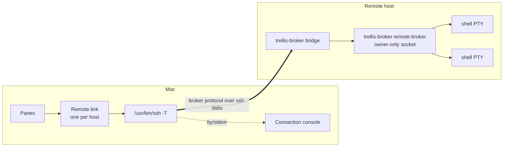

# Remote workspaces

A remote workspace is a sidebar window bound to a [saved SSH host](ssh-hosts.md). Every tab and split in it runs a shell on that host, in a session owned by a small Trellis helper running **on the remote machine**. The helper keeps sessions running when Trellis quits, the Mac sleeps or the network drops, and Trellis re-attaches to them with their recent output.

Remote hosts can run Linux (x86_64, aarch64) or macOS (arm64, x86_64). Trellis itself still runs only on macOS.

All requirements here are P1. **Status: draft.** The contract is agreed before code, and checks stay unchecked until observed (see [Status](../overview/status.md)).

## How it works



- **One ssh process per host.** All windows bound to the same host share one link. Trellis runs the system `/usr/bin/ssh` (INT-03), with the host's saved fields, `-T` (no remote TTY) and `-e none` (no escape character), `-o ClearAllForwardings=yes` (port forwards from your SSH config belong to your own ssh sessions, so a link never binds them or fails on one already in use), and a short POSIX `sh` bootstrap as the remote command. Your SSH config, keys, agent, known-hosts policy and proxies apply as usual.
- **The bootstrap** reports the remote OS and architecture, installs the helper if it is missing and allowed (FR-RW02, FR-RW17), and then runs `trellis-broker bridge`. Probe, install and bridge share one connection, so you authenticate once. It is sent as one line, `exec /bin/sh -c 'eval "$(echo <base64> | base64 -d)"'`, which is built to parse the same in every common login shell (tested under sh, bash, zsh, ksh, dash, csh and tcsh; fish is pending). It answers one command per line on ssh's stdin (`install <digest> <bytes> gz|raw` followed by exactly that many bytes, `bridge`, `remove`, `quit`), and every reply carries a per-connection nonce, so login-script output can't forge one. Trellis sends nothing after an upload until the host acknowledges it, and output printed before the bridge's sync line is discarded.
- **The bridge** connects ssh's stdin and stdout to the remote broker's owner-only Unix socket, starting the broker if needed. The broker speaks the same framed protocol as the local [session broker](../architecture/sessions.md#session-broker) (protocol version 2).
- **The connection console** is a terminal attached to ssh's own TTY and stderr. Host-key confirmations, passwords, passphrases and one-time codes appear there, exactly as ssh asks them (FR-H04). Saved passwords are answered through `trellis-askpass` as for SSH panes (FR-H08).
- **Nothing listens on the network.** The remote broker uses only a Unix socket. SSH is the only transport and the only authentication between the Mac and the host.

## Requirements

| ID | Requirement | Acceptance check |
| --- | --- | --- |
| FR-RW01 | Open a saved host as a remote workspace window. | **Open Remote Workspace** in the host library and the command palette creates a window named after the host, bound to it, with one tab. The sidebar shows the host and the link state. Relaunch keeps the binding. A window whose host was deleted shows "Saved host missing" and starts nothing. |
| FR-RW02 | Install the helper only with consent, verified, atomically, without root. | Before the first install on a host, a sheet shows the host, the remote OS and architecture, the install path and the size; declining writes nothing. With **Install helper automatically** on for the host (FR-RW17), later versions install without asking. The upload is checked against the SHA-256 digest bundled with the app, then moved into place: a truncated or corrupt upload leaves no executable. An unsupported OS or architecture is refused and named. A host that already has the matching digest skips the upload. Nothing outside `~/.trellis/` is written. |
| FR-RW03 | One SSH connection per host; SSH prompts stay interactive. | A changed host key shows ssh's warning in the console and the link fails. A password host prompts once per connection, not once per pane. argv and the remote command never contain a secret. |
| FR-RW04 | New tabs, splits and duplicates in a remote window run on that host, in the source pane's directory. | After `cd /srv/app`, ⌘T and ⌘D open shells in `/srv/app` on the same host. The directory comes only from the pane's authenticated shell-integration marks (FR-RW05); without them, or if the directory no longer exists, the shell starts in the remote home. |
| FR-RW05 | Remote shell integration with a per-session nonce. | zsh, bash and fish get Trellis's integration scripts, installed with the helper. The pane header shows the directory without the "unverified" hint and the host's name in bold dark green (`#259A4C` on dark themes, `#1B7A3A` on light), with a link that isn't connected named in words beside it. A mark printed without the session's nonce changes nothing. Other shells start plain, and a missing script means a plain shell, not a failure. |
| FR-RW06 | Remote sessions keep running across quit, sleep and network loss. | `sleep 600; echo done` survives ⌘Q and relaunch, Mac sleep and wake, and Wi-Fi off and on, and `done` appears. Quitting sends no signal to remote sessions. Closing a pane, tab or window ends its remote sessions after the usual confirmation (SIGHUP to the process group, guarded against PID reuse by the remote broker). Closing the native window detaches remote sessions (MAC-04). |
| FR-RW07 | Notice a lost link and reconnect automatically when that needs no input. | A lost link is noticed within 30 s of the last traffic (heartbeat every 15 s), and immediately after wake or a network change. Panes and the sidebar show **Reconnecting** as text plus a symbol; their sessions stay `running`. Typing shows "Not sent: reconnecting" and nothing is queued. Automatic attempts run ssh with `BatchMode=yes`, back off from 1 s to 60 s with jitter, and pause while the Mac is offline. **Retry Now** is always offered. If authentication would need input, automatic attempts stop and the pane offers **Reconnect…**, which opens the console. |
| FR-RW08 | Resume without duplicated output. | Output produced during an outage appears once after reconnect when it still fits the remote replay buffer (4 MiB per session). `seq 1 1000000` across a 10 s outage shows no repeated line. Otherwise the pane is reset and gets the most recent 4 MiB, as in FR-R03. Full-screen programs redraw. |
| FR-RW09 | Re-attach remote sessions after relaunch. | Restored remote panes re-attach by session UUID once their host is connected. A session that ended meanwhile shows its replay and "Session ended while disconnected (exit N)". Running sessions on the host that no pane claims get **Stop Them** / **Leave Running**, once per host. |
| FR-RW10 | Launch library projects on a host. A [project](project-library.md) launched on a saved host (FR-PL06) opens as a window bound to that host, every pane a shell there, in the project folder on the host. | The launch sheet checks the host's folders through the helper (`stat` only). The window is bound to the host like **Open Remote Workspace**, keeps running when Trellis quits, reconnects (FR-RW07) and re-attaches (FR-RW09). Trellis never writes a host's files itself: folders and clones are made by the setup terminal (FR-RW18), in your shell there. |
| FR-RW11 | Run tasks in remote panes. | The Tasks menu (FR-TK02) appears in remote panes with authenticated integration, listing the remote `launch.json` and detected tasks (FR-TK03), with the same trust, run, stop and status behavior. **Add to launch.json** is unavailable for remote panes. |
| FR-RW12 | Keep the remote side minimal and private. | No TCP listener is added on the remote (`ss -ltn` unchanged). Files under `~/.trellis/` are owner-only (directories 0700, files 0600, executables 0700); the socket is 0600 in a 0700 directory. No secret, nonce, typed input or terminal output is written to the remote disk, and neither side logs input or output. The broker reads only the allow-listed task file and task manifests (FR-RW11), owned by the user, without following symlinks, at most 256 KB each. Besides login shells it runs only a project's setup in your login shell (FR-RW18) and `git status` with a fixed argument list (FR-PL09). |
| FR-RW13 | Keep each Mac's sessions separate. | Each Trellis state directory has a random client ID; the remote broker is per client ID. Two Macs on the same host see only their own sessions. After a network drop, the same Mac takes over its stale connection instead of failing with `BROKER_BUSY`. |
| FR-RW14 | Upgrade without losing sessions. | After a Trellis update, a running older remote broker that speaks a supported protocol version keeps its sessions and is used until it exits. Otherwise Trellis says so and offers to stop it. Unused helper versions are removed (`gc`), never one with a running broker. |
| FR-RW15 | Automation sees remote sessions. | `session.get` reports `launchKind: "remoteShell"`, the `hostId` and the host's `remoteLink` state with host-read access to that host and the starting `directory` (a path on the host) with execute permission; `currentDirectory` is never reported. Starting, restarting, input and `session.execute` into a remote session need host access for that host, as `host.connect` does. While the host isn't connected, input and `session.execute` fail with `REMOTE_DISCONNECTED` and nothing is queued. Automation can't create remote workspace windows in this version. |
| FR-RW16 | Accessible link state. | Link states are words plus symbols, never color alone. VoiceOver reads, for example, "Reconnecting to build-box, attempt 3". Moving focus to the console when ssh asks for input is announced. |
| FR-RW17 | Install and manage the helper from the saved host. | Each host in the host library has **Install Trellis Helper…**, **Update Helper…**, **Check Helper Status** and **Remove Helper…**, and a status line: "Unknown (never checked)", "Not installed (Linux aarch64)", "Installed, up to date (Linux aarch64)", "Update available (Linux aarch64)" or "Not available for FreeBSD amd64", with when it was checked. The status is only ever recorded from an actual probe, never inferred, and saved per host in `remote-hosts.json`. Each action uses the same link, console, confirmation, digest check and atomic write as FR-RW02. Remove deletes only `~/.trellis/remote` and `~/.trellis/run` (and `~/.trellis` when that leaves it empty), which affects every Mac using the host, and is refused while this Mac's broker there (of any installed version) has running sessions unless you confirm stopping them, and whenever those sessions can't be counted. The host has **Install helper automatically when opening a remote workspace**, off by default and saved beside its status; when off, opening a workspace on a host without the helper shows the install sheet. Cancelling at any prompt leaves the remote unchanged. |
| FR-RW18 | Run a project's setup on the host. **Set Up & Open** (FR-PL07) on a host starts a session there whose login shell runs the setup script instead of an interactive shell: `<shell> -l -c` with the same login environment as a remote pane, so an agent forwarded by ssh is available to git. | The setup terminal shows the host's git output and prompts. Its exit status decides success. With a helper that predates this (protocol 2) still running, setup doesn't start and says to update the helper (FR-RW17); nothing runs an interactive shell in its place. A csh or tcsh login shell runs the setup through `/bin/sh -l`, since they take `-l` only alone. `BrokerBridgeTests` and `RemoteProjectLaunchTests` cover both. The script is fixed text plus validated folder, URL and branch values, so nothing else is typed or run. |

## Remote files

```text
~/.trellis/                         0700
  remote/<digest-16>/               0700, one per helper version
    trellis-broker                  0700
    integration/                    zsh, bash and fish scripts
  run/<client-id>/broker.json       0600, socket path and protocol version
/tmp/trellis-broker-<hex>/s         socket 0600 in a 0700 directory
```

On the Mac, `remote-client.json` (client ID) and `remote-hosts.json` (last probed helper status per host) live in the state directory, owner-only. Neither holds a secret.

## Session and link state

The link has its own state, kept only while Trellis runs: **Connecting**, **Needs input**, **Connected**, **Reconnecting**, **Offline** and **Failed**. It is not a session state. A remote session is `running` while its remote process is alive, whether or not the link is up, and the [session lifecycle](../architecture/sessions.md) is unchanged. Restored remote panes start `stopped`, as FR-R01 requires, and become `running` only by re-attaching to a session the remote broker still has (FR-RW09). Typed input is never replayed or queued.

## Limits

- Remote sessions survive what the remote machine survives. A reboot, a logout policy that kills user processes (systemd `KillUserProcesses=yes`) or a broker crash ends them. Trellis warns when it detects such a policy and never enables lingering for you.
- Shells started before a reconnect keep the old `SSH_AUTH_SOCK`, so agent forwarding inside them stops working after a reconnect, as with tmux.
- A session that ended while disconnected keeps its exit status and replay on the host for one day; after that, with nothing else running, the remote broker exits and the pane shows only that its session is gone.
- A pane closed while its host is unreachable is hung up at the next reconnect in the same run; the hang-up isn't saved, so after a quit (or Close All Workspaces with no remote window left) that session keeps running on the host until the orphan prompt offers it.
- Starting a restored remote pane by hand before its host has re-attached it fails (the helper still runs that session); choose **Reconnect** instead.
- If the host doesn't answer a session start within 5 seconds, the pane shows Failed even if the shell started; it then appears in the orphan prompt.
- Only one Mac can attach a given set of sessions; taking over another Mac's sessions isn't supported.
- Opening remote file links, editing remote task files and general file transfer are not included.
- Automatic reconnect needs non-interactive authentication (keys or an agent). Saved passwords are used for interactive reconnects only, so a host that logs in with a password always stops at **Reconnect needs you** after a drop; choose **Reconnect…**.

## Implementation notes and verification

The remote helper is the same `trellis-broker` as the local [session broker](../architecture/sessions.md#session-broker), with two subcommands: `bridge` (run by ssh) and `remote-broker` (started by the bridge, per client ID). It builds for Linux from the same sources; on Linux the package manifest declares only the helper and its tests.

| Check | Result |
| --- | --- |
| Language | Kept in Swift. The size gate (rewrite in C++ if the static binary were clearly over about 10 MB) was not met. |
| Static Linux build | Swift 6.4.1 with the static Linux SDK 0.1.0 (musl), in Docker: builds for aarch64 and x86_64. Stripped, `-Osize`, `--gc-sections`: 10.9 MB (aarch64) and 11.9 MB (x86_64), 4.1 MB and 4.4 MB gzipped. FoundationEssentials only, no ICU. |
| Runs on stock distributions | The static aarch64 binary starts on Alpine 3, Debian stable and Ubuntu 20.04 containers. x86_64 binaries and real hosts: **pending**. |
| Linux tests | `scripts/test-linux.sh` (and the CI job `linux-broker`): the broker suite, including the bridge end-to-end tests with real PTYs, passes on Linux aarch64 (glibc, Swift 6.4.1). |
| Resume, takeover, client isolation, file allow-list | Covered by `BrokerBridgeTests` and `BrokerRemoteTests` on macOS and Linux. |
| Link and deploy on the Mac | `RemoteHostLinkTests` run the real bootstrap, upload, host-side digest check, bridge and broker through a fake `ssh` under a temporary `HOME`: declining writes nothing, a helper whose digest doesn't match is deleted on the host, a changed bundled file is never uploaded, and ssh's messages reach the console. `RemoteHelperInstallTests` cover the host-library actions. |
| Real SSH host | `scripts/test-remote-docker.sh` (opt-in, needs Docker): a disposable Debian aarch64 sshd, key login, the gzipped static helper installed over real `ssh`, a login shell run through the bridge, the link closed while a command ran, then resumed with the missed output exactly once, and the helper removed. Passed on Apple silicon with Docker 28. x86_64 hosts: **pending**. |
| Login shells | The bootstrap command runs and reports its probe under sh, zsh, bash, dash, ksh, csh and tcsh (`RemoteLinkTests`). fish and busybox ash: **pending**. |
| Remote workspace windows | `RemoteWorkspaceTests` drive the app model through the fake `ssh`: **Open Remote Workspace** creates a window bound to the host; its shell runs on the host with Trellis's integration, so its directory is authenticated (and never used locally); a split runs on the same host in that directory; quitting sends no signal; after a relaunch both panes re-attach by session UUID with the output produced meanwhile; a lost link keeps sessions running and refuses input; a pane closed while disconnected is hung up after **Reconnect**; the missed output appears once. `RemoteWorkspaceStoreTests` cover the store rules and the schema version. |
| Automatic reconnect (FR-RW07) | `RemoteReconnectTests` through the fake `ssh`: a dropped connection reconnects on its own after the first backoff and resumes with the missed output once; refused connections back off 1, 2, 4 s… and recover when the host answers; an attempt that needs a password stops automatic attempts after one try and shows **Reconnect needs you** until **Reconnect…**; offline pauses attempts and the network's return retries at once; **Retry Now** doesn't wait; wake, or a network change while still online, finds a silently dead link (a frozen ssh) within 5 s. Classification and backoff are unit-tested. The command palette lists **Open Remote Workspace: <host>** beside each host's Connect item (`RemoteWorkspaceTests`). Wake, Wi-Fi changes and sleep on a real Mac: **pending**. |
| Export and import (FR-R02) | `PortableTransferTests`: a remote workspace exports with `remoteHostId` pointing at the export's own host reference, and its pane as a shell in its host path; importing binds the window to the imported or kept host, starts nothing, and lists no host folder as a local one. API layouts with `remoteHostId` are rejected. |
| Remote tasks (FR-RW11) | `RemoteTasksTests` through the fake `ssh`: the Tasks menu lists the host's `launch.json` and detected tasks; a file task waits for review naming the host and then runs in the remote shell; the same file through another saved host asks again (trust is keyed by host, remote machine and real path); nothing is ever written on the host. How it reads: the same local lookup and detection code runs over facts fetched from the helper (`stat` and allow-listed reads), re-run until it asks nothing new. |
| Packaging | `scripts/build-remote-helpers.sh` builds the Linux helpers in Docker and writes them gzipped with `remote-helpers.json` (helper and file SHA-256). `run-feasibility.sh` and `package-release.sh` bundle them in `Contents/Resources/remote` when built (data, not code: `codesign` refuses unsigned files under `Contents/Helpers`); without them only macOS hosts can be set up. The release workflow builds them in a `swift:6.4.1` Linux container job and passes them to the macOS packaging job; the musl, mimalloc and musl-fts notices ship beside them (`ThirdParty/RemoteHelpers/`). The workflow change itself runs only on the next tagged release: **pending** until then. |
| Keystroke latency | `scripts/qualify.py --remote-only` against a Docker sshd on Apple silicon (loopback, OpenSSH 10.3 client), with the script speaking the helper's session protocol (not the app): echo p50 1.3 ms, p95 3.5 ms (n=60, `--quick`); a plain `ssh -tt` shell measured the same way with `ObscureKeystrokeTiming=no`, p50 0.7 ms, p95 1.4 ms, and with OpenSSH's default keystroke timing obfuscation, p50 16.7 ms, p95 20.4 ms. The `ssh -T` bridge has no PTY, so OpenSSH doesn't obscure remote workspace keystroke timing. Over a real network: **pending**. |
| `ssh -T` keystroke latency over a real network, logind `KillUserProcesses=yes` on a real systemd host, password and one-time-code prompts in the console, a changed host key | **Pending.** Detection of the logind setting is unit-tested only; the console is tested with ssh's error output only. |

